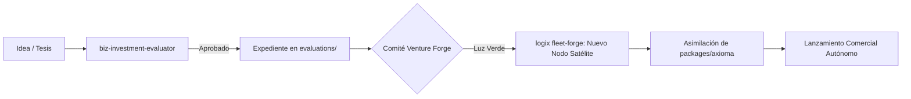

# Venture Forge & Satellite Studio Governance

## 1. Visión y Propósito
Este skill encapsula la metodología de la fábrica federada (`Venture Forge`) para evaluar, estructurar y desplegar nuevas empresas satélite a partir de capacidades tecnológicas probadas en la flota CONEXT.

Convierte proyectos validados en `evaluations/` en nodos operativos autónomos (`fleet.json`) con gobernanza compartida, aislamiento sónico y contratos de interoperabilidad limpios.

---

## 2. Ciclo de Vida de Incubación de un Satélite



1. **Fase 1: Tesis y Screening**: Superación de compuertas Go/No-Go y Due Diligence cuantitativo ($I_c \ge 8.0$).
2. **Fase 2: Arquitectura del Spin-Off**:
   - Definición de dominio puro e interfaces desacopladas.
   - Declaración de modelo de monetización (SaaS B2B, intermediación comercial o licencias).
3. **Fase 3: Aprovisionamiento en Flota**:
   - Registro formal en `vault/fleet.json`.
   - Inyección de ADN base y doctrinas maestras (`GEMINI.md`).
4. **Fase 4: Gobernanza y Retorno de Valor**:
   - Monitoreo continuo de telemetría y Kill Criteria.
   - Sincronización de dividendos tecnológicos hacia el núcleo (`packages/axioma`).

---

## 3. Salida Estándar para Expedientes de Forja

```markdown
### [EXPEDIENTE VENTURE FORGE: <NOMBRE_STARTUP>]
- **Tesis de Negocio**: <Problema urgente que resuelve y mercado objetivo>
- **Modelo de Ingresos**: [SaaS B2B | Transaccional | Marketplace | Licenciamiento]
- **Nodos Aliados en la Flota**: [<Nodo 1>, <Nodo 2>]
- **Axiomas a Consumir**: [<Axioma 1>, <Axioma 2>]
- **Hito de Validación MVP**: <Métrica obligatoria a 60 días>
- **Estado de Forja**: [EN INCUBACIÓN | LISTO PARA FORJAR | DESESTIMADO]
```
