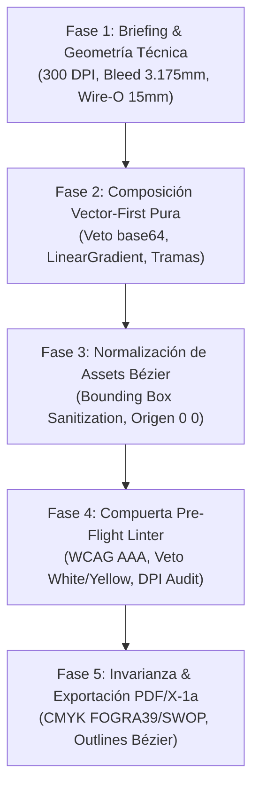

# Editorial Design B2B — Especificación de Ingeniería y Producción Gráfica Impresa (Print-Ready)

## 1. Visión y Propósito
El skill `editorial-design-b2b` extiende la factoría publicitaria de Studio desde el plano digital (pantallas sRGB) hacia el ecosistema físico comercial e industrial en offset y prensa digital (CMYK):
* **Formatos de Alto Rendimiento**: Trípticos (Letter / A4 en 3 cuerpos asimétricos), dípticos corporativos, catálogos técnicos B2B con encuadernación Wire-O o espiral, manuales de especificación, flyers comerciales y material POP de gran escala.
* **Tolerancia Cero a Desvíos en Prensa**: Eliminación completa de artefactos de rasterizado, fuentes no incrustadas, empaste por desregistro cromático (*misregistration*) y corte accidental de elementos informativos críticos.
* **Pureza Vector-First**: Máxima fidelidad e invarianza de escala. Las primitivas de diseño, geometrías, gradientes e isotipos son código SVG declarativo puro, sin contaminación de mapas de bits base64.

---

## 2. Matriz Canónica de Contrastes y Paletas de Marca (Goodyear B2B Fleet Standard)

La legibilidad en sustrato físico (papel estucado, mate, bond o sustratos vinílicos) está gobernada por la interacción de tintas CMYK y luminancia relativa percibida ($L$). El pre-flight editorial aplica los umbrales WCAG 2.1 AAA/AA adaptados a reflectancia de tinta.

### Fórmulas de Luminancia y Contraste
Para un color sRGB normalizado con canales $R, G, B \in [0, 1]$:
$$C_{\text{lin}} = \begin{cases} \frac{C}{12.92} & \text{si } C \le 0.04045 \\ \left(\frac{C + 0.055}{1.055}\right)^{2.4} & \text{si } C > 0.04045 \end{cases}$$

Luminancia relativa:
$$L = 0.2126 \times R_{\text{lin}} + 0.7152 \times G_{\text{lin}} + 0.0722 \times B_{\text{lin}}$$

Ratio de contraste entre luminancias $L_1$ (mayor) y $L_2$ (menor):
$$\text{CR} = \frac{L_1 + 0.05}{L_2 + 0.05}$$

### Matriz de Validación Pre-Flight

| Color Primer Plano (Foreground) | Color Fondo (Background) | Luminancias ($L_1 : L_2$) | Ratio de Contraste | Dictamen Pre-Flight | Justificación Técnica & Comportamiento Offset |
| :--- | :--- | :--- | :--- | :--- | :--- |
| **Goodyear Navy** (`#001C4D`) | **Goodyear Yellow** (`#FFD100`) | $0.6558 : 0.0162$ | **10.66:1** | **APROBADO (AAA)** | Máxima legibilidad diurna. Fuerte contraste tonal entre longitud de onda azul oscura y amarillo espectral. |
| **Goodyear Yellow** (`#FFD100`) | **Goodyear Navy** (`#001C4D`) | $0.6558 : 0.0162$ | **10.66:1** | **APROBADO (AAA)** | Alto impacto visual para Packshots Hero, badges de rendimiento y titulares de portada. |
| **Pure White** (`#FFFFFF`) | **Goodyear Navy** (`#001C4D`) | $1.0000 : 0.0162$ | **15.86:1** (>14:1) | **APROBADO (AAA)** | Ratio superior a 14:1. Mandatorio para cuerpos de texto legal, tablas de especificaciones técnicas y tipografía en cuerpos pequeños (≤10pt). |
| **Pure White** (`#FFFFFF`) | **Goodyear Yellow** (`#FFD100`) | $1.0000 : 0.6558$ | **1.49:1** | **VETO ESTRICTO (FATAL DRIFT)** | **PROHIBIDO**. Produce ceguera cromática y empaste total en tiraje offset. La compuerta Pre-Flight aborta automáticamente la compilación si detecta este par. |
| **Goodyear Navy** (`#001C4D`) | **Pure White** (`#FFFFFF`) | $1.0000 : 0.0162$ | **15.86:1** | **APROBADO (AAA)** | Estándar editorial para lectura prolongada sobre papel bond o estucado brillante. |

> [!CAUTION]
> **Veto Constitucional a Blanco sobre Amarillo**: Cualquier intento de componer texto en `#FFFFFF` sobre fondos amarillos (`#FFD100` o `#FFCC00`) constituye un fallo crítico de accesibilidad física y será rechazado por el linter de pre-flight sin excepción.

---

## 3. Protocolo de Ingeniería en 5 Fases (Workflow DAG)



---

### Fase 1: Briefing y Geometría Técnica

1. **Resolución Nominal**: Todos los cálculos de escala y conversión dimensional operan a **300 DPI reales** ($1 \text{ pulgada} = 300 \text{ px}$ en raster de assets, $1 \text{ pt} = \frac{1}{72} \text{ pulgada} \approx 4.167 \text{ px a 300 DPI}$).
2. **Sangrado Perimetral (*Bleed*)**:
   - Todo archivo destinado a guillotina debe incluir **0.125 pulgadas (3.175 mm / 9 pt)** de excedente perimetral en los 4 bordes.
   - Fondos, gradientes y texturas de borde deben extenderse hasta el límite exterior del *Bleed Box*.
3. **Margen de Seguridad (*Safe Area*)**:
   - Margen perimetral general: Mínimo **0.25 pulgadas (6.35 mm)** hacia adentro del *Trim Line*. Ningún texto, logotipo o isotipo puede cruzar esta línea.
   - **Wire-O / Espiral Safety**: En documentos encuadernados con anillado metálico doble o espiral plástica, el lomo de perforación requiere un margen de seguridad estricto de **15.0 mm (0.59 pulgadas)**. Esto previene que el troquel de los dientes metálicos mutile caracteres tipográficos o diagramas técnicos.
4. **Cajas de Página Normalizadas (PDF Page Boxes)**:
   - **MediaBox**: Dimensión física del pliego o papel crudo de impresión.
   - **BleedBox**: Límites del área sangrada ($TrimBox + 3.175 \text{ mm}$ por lado).
   - **TrimBox**: Dimensiones del corte final del documento terminado.
   - **ArtBox**: Área de seguridad interior donde se confina el contenido crítico.
   - **Slug Area**: Franja técnica de 0.5" fuera del BleedBox para marcas de registro, barras de densidad de tinta CMYK y sello de tiraje.
5. **Geometría de Tríptico Asimétrico (Letter C-Fold)**:
   - Para prevenir que el panel plegado hacia adentro force el lomo o genere abombamiento (*buckling*), los 3 paneles se dimensionan asimétricamente:
     * **Panel Portada (Exterior)**: $3.6875 \text{ in} \times 8.50 \text{ in}$ ($93.66 \times 215.9 \text{ mm}$).
     * **Panel Central (Dorso)**: $3.6875 \text{ in} \times 8.50 \text{ in}$ ($93.66 \times 215.9 \text{ mm}$).
     * **Panel Solapa Interior**: $3.6250 \text{ in} \times 8.50 \text{ in}$ ($92.08 \times 215.9 \text{ mm}$) — Reducción de $\frac{1}{16}"$ (1.58 mm).

---

### Fase 2: Composición Vector-First Pura

1. **Veto Estricto a Raster Base64 en Geometría**:
   - Queda terminantemente prohibido incrustar elementos geométricos, fondos, badges, cintas o iconos mediante etiquetas `<image xlink:href="data:image/png;base64,...">`.
   - Única excepción permitida: Fotografía de producto real o Packshot Hero renderizado con canal alfa a 300+ DPI reales, referenciado como recurso de alta resolución.
2. **Gradientes Vectoriales Nativos**:
   - Todo degradado se declara mediante `<linearGradient>` o `<radialGradient>` con paradas `<stop>` explícitas en `defs`.
   - Se debe definir `gradientUnits="userSpaceOnUse"` o `gradientUnits="objectBoundingBox"` con coordenadas normalizadas.
   ```xml
   <defs>
     <linearGradient id="goodyear-hero-grad" x1="0%" y1="0%" x2="100%" y2="100%">
       <stop offset="0%" stop-color="#001C4D" stop-opacity="1" />
       <stop offset="100%" stop-color="#000E26" stop-opacity="1" />
     </linearGradient>
   </defs>
   ```
3. **Tramas Vectoriales Procedurales**:
   - Texturas de fondo, grillas industriales y patrones de seguridad no se rasterizan. Se definen en `<pattern>` nativo:
   ```xml
   <defs>
     <pattern id="industrial-dot-matrix" x="0" y="0" width="12" height="12" patternUnits="userSpaceOnUse">
       <circle cx="6" cy="6" r="1.2" fill="#FFD100" fill-opacity="0.15" />
     </pattern>
   </defs>
   ```
4. **Jerarquía Semántica de Capas SVG**:
   ```xml
   <svg xmlns="http://www.w3.org/2000/svg" viewBox="0 0 816 1056" width="8.5in" height="11in">
     <defs><!-- Gradientes, patrones y máscaras Bézier --></defs>
     <g id="layer-bleed-background"><!-- Fondos extendidos +3.175mm --></g>
     <g id="layer-geometric-patterns"><!-- Tramas procedurales vectoriales --></g>
     <g id="layer-vector-assets"><!-- Isotipos, badges normalizados Bézier --></g>
     <g id="layer-typography-outlines"><!-- Tipografías convertidas a curvas --></g>
   </svg>
   ```

---

### Fase 3: Normalización de Assets Bézier (Bounding Box Sanitization)

Los assets vectoriales crudos exportados desde herramientas de diseño suelen contener coordenadas globales desplazadas, márgenes residuales y cajas de colisión infladas. La normalización física de cada path Bézier es obligatoria:

1. **Cálculo Matemático de Extremos Bézier**:
   - Para curvas cúbicas $B(t) = (1-t)^3 P_0 + 3(1-t)^2 t P_1 + 3(1-t) t^2 P_2 + t^3 P_3$, se calculan las raíces de la derivada $B'(t) = 0$:
     $$A = -P_0 + 3P_1 - 3P_2 + P_3, \quad B = 2(P_0 - 2P_1 + P_2), \quad C = P_1 - P_0$$
     $$A t^2 + B t + C = 0 \implies t = \frac{-B \pm \sqrt{B^2 - 4AC}}{2A}$$
   - Se evalúa $B(t)$ en los puntos críticos $t \in (0, 1)$ y en los extremos $t \in \{0, 1\}$ para obtener $[x_{\min}, x_{\max}]$ y $[y_{\min}, y_{\max}]$ exactos.
2. **Traslación Rígida al Origen $(0, 0)$**:
   - Cada coordenada absoluta $(x, y)$ se desplaza:
     $$x' = x - x_{\min}, \quad y' = y - y_{\min}$$
   - El bounding box resultante comienza estrictamente en $(0, 0)$ con dimensiones $w = x_{\max} - x_{\min}$ y $h = y_{\max} - y_{\min}$.
3. **Asignación Estricta de `viewBox`**:
   - Todo asset procesado se encapsula con `viewBox="0 0 {w} {h}"`, eliminando colisiones de capas z-index y márgenes fantasma.
4. **Ejecución vía CLI Tooling**:
   ```bash
   python3 .agents/skills/editorial-design-b2b/scripts/normalize_vector_asset.py \
     --input raw_badge.svg \
     --output sanitized_badge.svg \
     --json-meta
   ```

---

### Fase 4: Compuerta Pre-Flight Linter

Antes de autorizar el pase a compilación final, el motor editorial ejecuta un chequeo no negociable:

1. **Linter de Contraste WCAG**:
   - Todo texto o isotipo contrastado contra su fondo debe satisfacer $\text{CR} \ge 4.5:1$ (texto estándar) o $\ge 3.0:1$ (titulares grandes $\ge 18\text{pt}$).
   - **Veto de Rechazo Automático**: Detección de texto blanco (`#FFFFFF` o similar con luminancia $>0.9$) sobre fondos con luminancia $>0.6$ (incluyendo Goodyear Yellow `#FFD100`).
2. **Auditoría de Invasión de Zonas Seguras**:
   - Distancia de elementos vectoriales de contenido respecto al Trim line $\ge 6.35 \text{ mm}$.
   - En catálogos con encuadernación Wire-O: Distancia respecto al borde de perforación $\ge 15.0 \text{ mm}$.
3. **Auditoría de Mapas de Bits**:
   - Escaneo de etiquetas `<image>`:
     * Si el tag representa una forma o ilustración: **RECHAZO**.
     * Si es una fotografía de producto: Debe certificar $\text{DPI} = \frac{\text{PixelWidth}}{\text{DisplayInches}} \ge 300$.
4. **Doble Estándar para Tintas Negras (Rich Black vs Pure Black)**:
   - **Texto Pequeño (≤ 12 pt)**: Obligatoriamente *Pure Black* 100% K (`C:0 M:0 Y:0 K:100`) para impedir bordes borrosos por desalineación de planchas offset.
   - **Fondos y Bloques Extensos**: *Rich Black B2B* (`C:60 M:40 Y:40 K:100`) para lograr un negro profundo, uniforme y saturado sin repinte.

---

### Fase 5: Invarianza de Escala y Exportación PDF/X-1a

1. **Estándar de Interoperabilidad**:
   - Salida certificada bajo la norma **ISO 15930-1:2001 (PDF/X-1a)**.
   - Todos los RIPs industriales (Agfa Apogee, Kodak Prinergy, Heidelberg Prinect) requieren este estándar para procesar archivos sin requerir intervención manual del operador.
2. **Espacios de Color de Destino (ICC Profiles)**:
   - **Europa / Mercosur**: `FOGRA39` (ISO 12647-2:2004 para papel estucado / coated).
   - **Norteamérica**: `U.S. Web Coated (SWOP) v2` o `GRACoL2006_Coated1v2`.
   - Prohibido cualquier objeto en espacio RGB o perfiles incrustados no balanceados dentro del PDF final.
3. **Conversión Obligatoria a Curvas (Outlines Bézier)**:
   - Todas las etiquetas de texto tipográfico `<text>` deben ser convertidas a trazados Bézier vectoriales nativos (`<path d="...">`). Esto elimina de forma definitiva el error clásico de fuentes ausentes o sustituciones de glifos en imprenta.
4. **Marcas de Imprenta en Slug**:
   - Marcas de corte (*Crop Marks*) alineadas al TrimBox.
   - Marcas de registro con círculos concéntricos cruzados para calibración milimétrica de planchas.
   - Tira de control cromático (cuñas de control de densidad CMYK al 25%, 50%, 75% y 100%).

---

## 4. Arquitectura de Módulos y Herramientas

```text
.agents/skills/editorial-design-b2b/
├── SKILL.md                          <-- Especificación de Ingeniería (Este documento)
├── skill.json                        <-- Catálogo y metadata del skill
└── scripts/
    └── normalize_vector_asset.py     <-- CLI de sanitización matemática de paths Bézier
```

---

## 5. Automatización InDesign (ExtendScript & UXP)

Para flujos de trabajo conectados a Adobe InDesign Server o estaciones desktop locales, el pipeline editorial soporta la inyección directa de geometrías y pre-flights vía scripts:
* **ExtendScript (`.jsx`)**: Generación programática de pliegos, configuración automática de sangrado (`documentPreferences.documentBleedUniformSize = "3.175mm"`), aplicación de estilos de párrafo con colores CMYK calibrados y empaquetado a PDF/X-1a.
* **UXP Scripting (`.idjs`)**: Ejecución asíncrona moderna en InDesign 2024+, permitiendo streaming de assets normalizados en disco hacia el layout activo con paridad test-to-prod.
