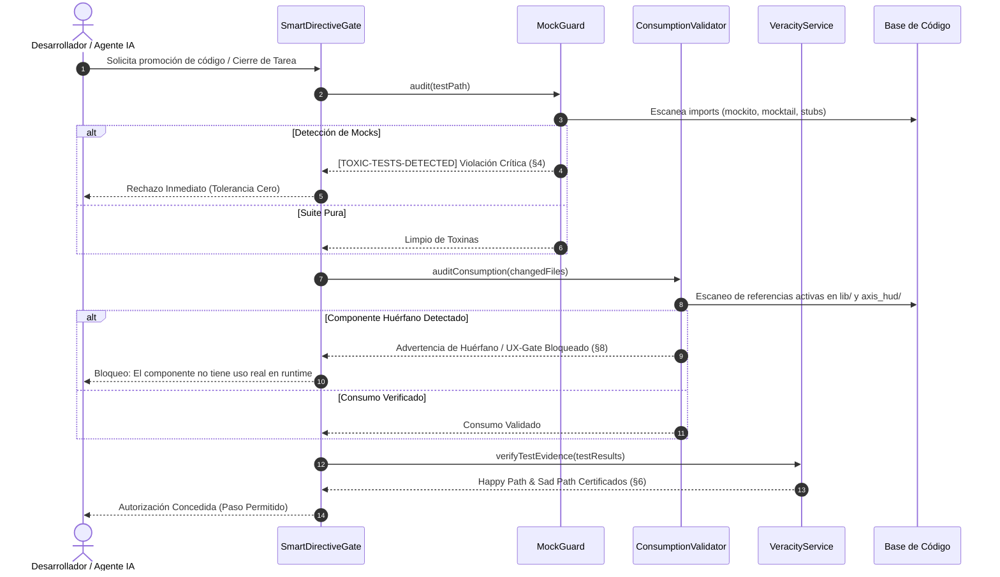

# gov-antagonist-audit: Auditoría Antagónica y Guardián de Veracidad

## 1. Declaración de Misión y Filosofía
El Skill `gov-antagonist-audit` implementa la doctrina del **Auditor Antagonista y Tolerancia Cero a Mocks (§4)** en el ciclo de vida del software en toda la flota. En sistemas asistidos por IA, existe una propensión recurrente a falsear suites de pruebas mediante stubs superficiales (`mockito`, `mocktail`), generar funciones no consumidas (código huérfano/zombie, §8) o declarar tareas concluidas sin respaldo empírico de sad paths (§6).

Este skill provee los mecanismos de auditoría automatizada que actúan como fiscales independientes de calidad:
- **`MockGuard`**: Escaneo AST y proscripción absoluta de bibliotecas de simulación o datos sintéticos en `test/` y código de producción (§4).
- **`ConsumptionValidator` (UX-Gate)**: Detección estricta de componentes huérfanos que no están integrados ni consumidos por la aplicación, CLI o HUD (§8, §40).
- **`VeracityService`**: Verificación forense de evidencia física (Happy Path + Sad Path mandatorio con `throwsA` o `isA<Exception>`) antes de autorizar transiciones de estado en el backlog (§6, §43, §48).

---

## 2. Flujo de Auditoría Antagónica



---

## 3. Especificación Formal de Interfaces (TypeScript Contracts)

```typescript
export interface MockViolation {
  readonly filePath: string;
  readonly prohibitedPackage: string;
  readonly lineIndex: number;
  readonly snippet: string;
}

export interface ConsumptionReport {
  readonly auditedFilesCount: number;
  readonly orphanComponents: Array<{
    readonly componentName: string;
    readonly filePath: string;
    readonly inferredClassName?: string;
  }>;
  readonly isClean: boolean;
  readonly saturationAborted: boolean;
}

export interface VeracityAuditResult {
  readonly isTruthful: boolean;
  readonly mockAuditPassed: boolean;
  readonly mockViolations: MockViolation[];
  readonly consumptionPassed: boolean;
  readonly orphanCount: number;
  readonly happyPathVerified: boolean;
  readonly sadPathVerified: boolean;
  readonly auditTimestamp: string;
}

export interface AntagonistAuditConfig {
  readonly prohibitedPackages: string[];
  readonly maxOrphanTolerance: number;
  readonly requireSadPathTest: boolean;
  readonly strictConsumptionEnforcement: boolean;
}

export interface IAntagonistAuditEngine {
  runMockGuard(projectRoot: string): Promise<{ isClean: boolean; violations: MockViolation[] }>;
  runConsumptionAudit(projectRoot: string, filesToAudit: string[]): Promise<ConsumptionReport>;
  evaluateVeracity(projectRoot: string, config: AntagonistAuditConfig): Promise<VeracityAuditResult>;
}
```

---

## 4. Herramientas y Scripts Ejecutables (`scripts/`)

* **Punto de Entrada Primario**: `.agents/skills/gov-antagonist-audit/scripts/antagonist_audit.py`
* **Entrypoint Alternativo CLI**: `dart run tools/claude_antagonistic_audit_runner.py`
* **Entorno**: Python 3.10+ / Dart SDK (Pure Dart agnóstico de UI, multi-OS vía `PlatformGuard`).

### Modos de Operación CLI

#### 1. Escaneo Completo Antagónico Anti-Mocks
```bash
python3 .agents/skills/gov-antagonist-audit/scripts/antagonist_audit.py \
  --scan-mocks \
  --path="test/" \
  --strict \
  --json
```

#### 2. Validación de Consumo de Componentes (UX-Gate Anti-Huérfanos)
```bash
python3 .agents/skills/gov-antagonist-audit/scripts/antagonist_audit.py \
  --audit-consumption \
  --source-dir="lib/src/" \
  --strict
```

#### 3. Certificación de Sad Paths (§6 Mandatorio)
```bash
python3 .agents/skills/gov-antagonist-audit/scripts/antagonist_audit.py \
  --verify-sad-paths \
  --test-dir="test/governance/" \
  --require-throws-a
```

### Tabla Determinista de Códigos de Salida
| Código | Estado | Significado Técnico |
| :---: | :--- | :--- |
| `0` | `AUDIT_SUCCESS` | Base de código pura, cero mocks y consumo certificado. |
| `1` | `MOCK_VIOLATION` | Detectado import tóxico (`mockito`, `mocktail`, `Mock`) (§4). |
| `2` | `ORPHAN_VIOLATION` | Clase o componente no consumido en runtime (§8, §40). |
| `3` | `MISSING_SAD_PATH` | Suite de tests carece de aserción negativa `throwsA` (§6). |
| `4` | `CLI_ARGUMENT_ERROR`| Argumentos de línea de comandos malformados o inválidos. |

---

## 5. Especificaciones de Tests Unitarios y Certificación Física (`test/`)

La certificación física de este skill opera contra repositorios reales y fixtures en disco, sin mocks (§4):
- **Happy Path 1 (Pureza Absoluta)**: Escaneo sobre suite de pruebas sin imports simulados retorna `isClean = true` y código `0`.
- **Happy Path 2 (Consumo Valido)**: Clase referenciada en `lib/smart.dart` o CLI pasa la compuerta UX-Gate con `orphanCount = 0`.
- **Sad Path 1 (§6 con throwsA)**: Inyección de `import 'package:mockito/mockito.dart'` en test temporal arroja `ToxicMockDetectedException`.
- **Sad Path 2 (§6 con throwsA)**: Test de cálculo sin bloque de captura negativa arroja `MissingSadPathAssertionException`.

---

## 6. Paridad Multi-OS y Perímetro Sónico
- **PlatformGuard**: Toda normalización de rutas de archivo utiliza separadores hacia adelante (`/`) para garantizar equivalencia matemática idéntica en Linux y Windows.
- **Perímetro Sónico (§2)**: Queda terminantemente prohibido escanear directorios fuera del búnker activo. Cualquier referencia foránea dispara `SonicPerimeterViolationException`.
