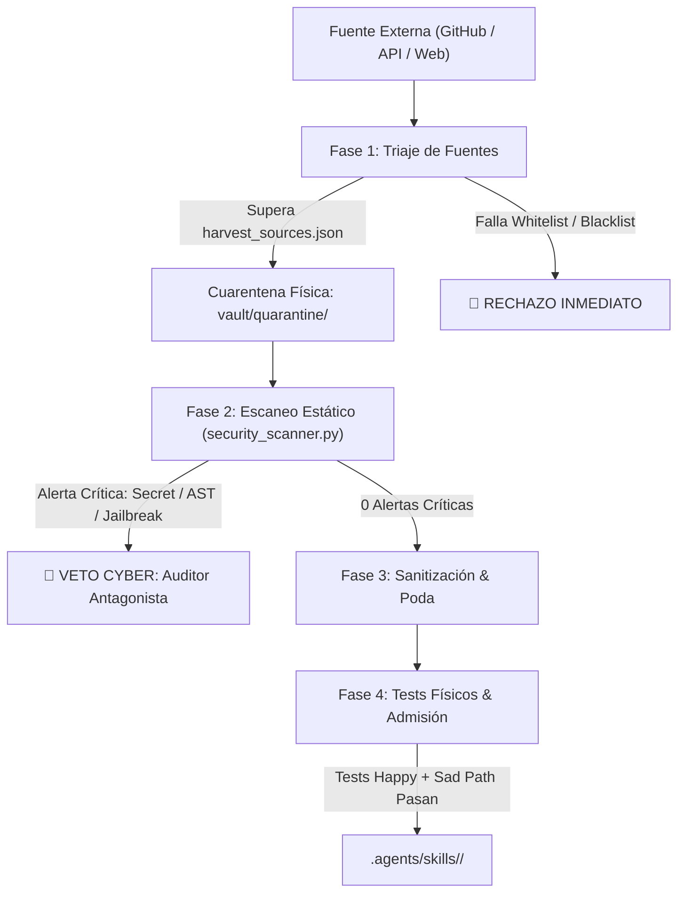

# Safe-Harvesting & Quarantine Protocol (safe_harvest_protocol.md)

## 1. Visión y Propósito
El **Protocolo de Cosecha Segura y Cuarentena** establece el procedimiento obligatorio para buscar, descargar, auditar y admitting código externo o skills de terceros en cualquier nodo de la flota CONEXT.

Garantiza la protección integral contra:
- **Exfiltración de credenciales y variables de entorno** (`.env`).
- **Inyección indirecta de prompts** en archivos de instrucciones (`SKILL.md`).
- **Ejecución remota de código arbitrario (RCE)** y dependencias envenenadas (Typosquatting).

---

## 2. Regla de Oro: Cuarentena Física Obligatoria

> [!CAUTION]
> Queda **ESTRICTAMENTE PROHIBIDO** descargar, clonar o escribir código cosechado de fuentes externas directamente en los directorios de producción: `lib/`, `src/`, `app/` o `.agents/skills/`.
> 
> Todo artefacto externo debe ingresar **exclusivamente** a la zona de aislamiento:
> `vault/quarantine/<nombre_candidato>/` o `scratch/harvest/`.

---

## 3. Ciclo de Admisión en 4 Fases



### Fase 1: Triaje de Fuentes (Whitelist / Blacklist)
Antes de extraer cualquier archivo:
1. Consultar [`harvest_sources.json`](file:///c:/Users/Ruben/Documents/Smart/.agents/skills/gov-fleet-governance/references/harvest_sources.json).
2. Si el dominio está en `blacklist.blocked_domains` o la licencia es `banned_licenses` (ej. GPL-3.0/AGPL-3.0), **abortar la cosecha en el acto**.
3. Verificar que el repositorio cumpla las reglas mínimas de reputación ($\ge 150$ estrellas, $\le 12$ meses de inactividad, licencia permisiva).

### Fase 2: Escaneo Estático Automatizado
El agente descarga los archivos candidatos **únicamente en formato texto/código** dentro de `vault/quarantine/` y ejecuta:
```bash
py .agents/skills/gov-fleet-governance/scripts/security_scanner.py vault/quarantine/<candidato>/ --json
```
- **Condición de Bloqueo**: Si `critical_issues > 0`, el **Auditor Antagonista** aplica su *Supply Chain Veto*. El archivo se purga de disco inmediatamente.

### Fase 3: Sanitización de Dependencias y Refactorización
1. **Poda de Bloatware**: Descartar cualquier framework pesado. Si una librería externa puede reemplazarse por la biblioteca estándar (`urllib.request`, `json`, `pathlib`), es obligatorio refactorizarla.
2. **Inyección de ResourceGuard (§33)**: Si el script realiza procesamiento intensivo (video, audio, scraping masivo), inyectar streaming por bloques de 8KB y límite de concurrencia de CPU.

### Fase 4: Certificación por Pruebas Físicas (§6) y Admisión
1. Escribir la suite de pruebas unitarias físicas en `test/test_<skill>.py` cubriendo el Happy Path y al menos un Sad Path (error de conexión, input vacío o inválido).
2. Ejecutar la suite:
   ```bash
   py -m unittest discover test
   ```
3. Solo cuando los tests pasen al 100% y se complete la evaluación Q1–Q7 de [`skill_quality_gate.md`](file:///c:/Users/Ruben/Documents/Smart/.agents/skills/gov-fleet-governance/references/skill_quality_gate.md), se traslada el directorio final a `.agents/skills/<suite>/`.

---

## 4. Política de Zero-Execution para Repositorios Externos
En ningún momento del proceso de cosecha está permitido ejecutar scripts de instalación de paquetes ajenos (`pip install -r requirements.txt`, `npm install`, `setup.py`) en el sistema operativo local. La lectura, parsing y análisis se realizan **estrictamente de forma estática**.
