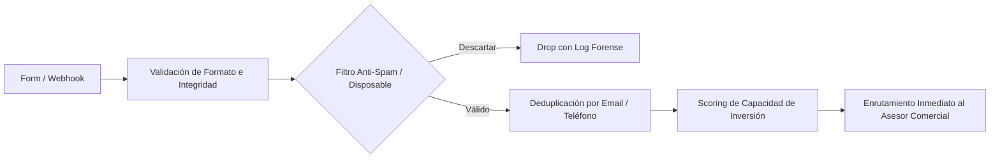

# Inbound Growth & Commercial Conversion Suite (lead-capture-pipeline)

## 1. Visión y Propósito
`lead-capture-pipeline` es la suite integral para el ciclo de adquisición y conversión comercial de la flota. Gobierna desde la entrada técnica de prospectos (formularios, webhooks, landings) hasta la extracción de inteligencia analítica sobre objeciones y motivos de compra en las conversaciones de venta.

Integra dos motores complementarios:
1. **Pipeline de Ingesta & Antifraude**: Validación de números E.164, bloqueo de correos temporales, deduplicación y scoring de temperatura (`HOT`, `WARM`, `NURTURING`).
2. **Inteligencia de Conversión y Objeciones**: Análisis de transcripciones de demos y llamadas para detectar objeciones de precio, tecnología o timing.

---

## 2. Arquitectura de Módulos (Sub-Referencias)

```text
.agents/skills/lead-capture-pipeline/
├── SKILL.md                          <-- Orquestador de Captura y Conversión (Este archivo)
└── references/
    └── voice_objections_insights.md  <-- Taxonomía de objeciones comerciales y análisis de sentimiento
```

---

## 3. Protocolo de Captura y Enrutamiento



1. **Validación Sintáctica y Antifraude**:
   - Detección y bloqueo de dominios de correo desechables (`disposable_email_domains.json`).
   - Normalización de números telefónicos en formato internacional E.164.
2. **Scoring de Calificación Inmediata**:
   - Evaluación del presupuesto declarado, horizonte temporal de compra y nivel de experiencia.
   - Clasificación en categorías: `HOT` ($\ge \$50k$ USD listos para invertir), `WARM`, `NURTURING`.
3. **Análisis de Objeciones Post-Llamada**:
   - Consultar [references/voice_objections_insights.md](file:///c:/Users/Ruben/Documents/Smart/.agents/skills/lead-capture-pipeline/references/voice_objections_insights.md) para clasificar las objeciones detectadas y alimentar el bucle de feedback comercial.
