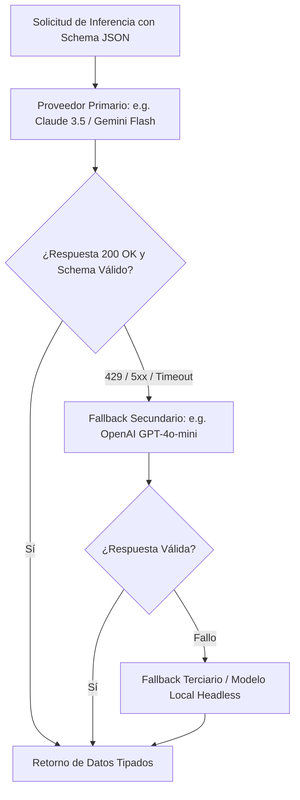

# Multi-Provider LLM Pool Query Dispatcher

## 1. Visión y Propósito
Este skill técnico abstrae las dependencias de proveedores específicos de inteligencia artificial. Garantiza que la flota CONEXT mantenga disponibilidad continua de inferencia para extracción de datos, razonamiento estructurado o generación de informes, incluso ante caídas de servicio, rate limits (HTTP 429) o degradación de latencia de un proveedor particular.

---

## 2. Jerarquía de Conmutación por Error (Fallback Cascade)



---

## 3. Garantías de Gobernanza y Control de Presupuesto

1. **Blindaje de Presupuesto por Consulta**:
   - `max_budget_per_call_usd`: Si la consulta proyecta superar el límite pre-fijado, aborta antes del envío.
2. **Validación Estricta de Esquema (Structured Output)**:
   - Forzado de JSON schema con validación Zod/Pydantic en destino.
   - Si la salida no cumple el esquema, ejecuta un reintento correctivo con temperatura 0.0.
3. **Manejo Seguro de Secretos**:
   - Lectura exclusiva desde variables de entorno seguras (`.env`) conforme a la doctrina de aislamiento del búnker.
4. **Guardarraíl de Invocación Cross-Node y Demarcación de Tiers (GAP-GOV-05)**:
   - **Restricción de Tier por Nodo**: Satélites operativos y Workers headless (`Automa / Jules`) operan exclusivamente en **Tier 1** (modelos de volumen y agilidad: Gemini Flash, etc.).
   - **Proscripción de Escalación Silenciosa a Tier 2**: Queda terminantemente prohibido que satélites o workers invoquen modelos de **Tier 2** (Claude Sonnet 5.5, Opus) directamente sin registrar previamente un evento formal en `vault/runtime/strategic_events.json` declarando la justificación (diagnóstico de `STALL`, mutación heurística de prompt o fallo crítico).
   - **Trazabilidad y Conciliación**: Toda inferencia escalada debe incluir `origin_tag` y estar sujeta a conciliación con la SSSoT en `Smart`.

---

## 4. Salida Estándar para Despachos de LLM

```markdown
### [DESPACHO LLM: QUERY <ID>]
- **Proveedor Utilizado**: [GEMINI | CLAUDE | OPENAI | LOCAL] (Estado: [PRIMARIO | FALLBACK])
- **Tokens Consumidos**: In: XXX | Out: YYY | Total: ZZZ
- **Costo de Inferencia**: $0.00XXXX USD
- **Latencia**: XXX ms
- **Validación de Schema JSON**: [CONFORME | CORREGIDO EN REINTENTO]
```
