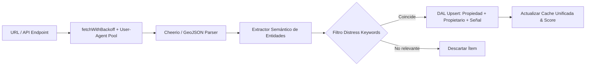

# Resilient Scraper Skill

## 1. Visión y Propósito
Este skill técnico provee un marco de trabajo desacoplado y robusto para la extracción e ingesta de datos desde fuentes públicas, portales web gubernamentales, feeds judiciales/inmobiliarios y APIs Open Data (e.g. ArcGIS REST, portales PMN). Resuelve bloqueos de IP, anomalías en el DOM y fallas intermitentes de red mediante rotación dinámica de encabezados, retardos adaptativos y almacenamiento atómico idempotente (UPSERT) en la capa DAL.

> **Origen Empírico**: Cosechado a partir de los motores de ingesta de `Smart`: `scripts/scrape_utahlegals.js`, `scripts/scrape_obituaries.js`, `scripts/open_data_ingest.js` y `scripts/dal/repositories.js`.

---

## 2. Capacidades de Infraestructura

### 2.1. Evasión de Bloqueos y Rotación de Identidad
- **Rotación de User-Agents**: Mantiene un pool dinámico de identificadores de navegador (Chrome, Safari, macOS, Windows) seleccionados aleatoriamente por solicitud.
- **Throttling y Control de Tasa (Rate Limiting)**:
  Inyección de pausas forzadas (`sleep(ms)`) entre descargas sucesivas para evitar detección por firmas volumétricas o activar captchas de seguridad.

### 2.2. Reintentos Resilientes con Retroceso Exponencial (`fetchWithBackoff`)
Algoritmo de reintentos configurable ante fallas HTTP de red o respuestas 5xx / 429:
$$T_{\text{delay}} = \text{baseDelay} \cdot 2^{\text{attempt}} + \text{jitter}$$
Permite absorber micro-caídas del servidor objetivo sin abortar el pipeline de datos.

### 2.3. Detección y Extracción Semántica por Expresiones Regulares
- **Extracción de Entidades**: Reconocimiento de fechas en múltiples formatos (`Jan 12, 2024`), personas/fiduciarios (`Trustor:\s*([^,]+)`), y direcciones postales con limpieza de caracteres especiales.
- **Clasificadores de Palabras Clave de Estrés**:
  Filtrado semántico en quejas de código o avisos de subasta (e.g. `['abandoned', 'structural', 'collapse', 'boarded up', 'vacant', 'tax default']`).

### 2.4. Persistencia Idempotente DAL (UPSERT Pattern)
- Inserción y actualización atómica evitando duplicación física:
  - Propiedades indexadas por combinación canónica de `address + zip_code`.
  - Propietarios indexados por `property_id + full_name`.
  - Señales de estrés indexadas por `property_id + signal_type + date_recorded`.
- Cálculo de Score Acumulativo de Oportunidad / Estrés:
  $$\text{Likelihood Score} = \sum_{i=1}^{n} \text{scoreWeight}_i$$

---

## 3. Especificación de Interfaces Contractuales

```typescript
interface ScraperTargetConfig {
  url: string;
  sourceId: string;
  maxRecordsPerBatch?: number; // default: 50
  timeoutMs?: number;          // default: 10000
  maxRetries?: number;         // default: 3
  baseDelayMs?: number;        // default: 2000
  headers?: Record<string, string>;
  distressKeywords?: string[];
}

interface ScrapedRawRecord {
  source: string;
  externalId?: string;
  rawText: string;
  extractedAddress?: string;
  extractedZip?: string;
  extractedOwner?: string;
  signalType: string;
  scoreWeight: number;
  dateRecorded: string;
  metadata?: Record<string, unknown>;
}

interface IngestionSummary {
  sourceId: string;
  recordsExtracted: number;
  propertiesUpserted: number;
  ownersUpserted: number;
  distressSignalsAdded: number;
  duplicatesSkipped: number;
  executionTimeMs: number;
}
```

---

## 4. Pipeline de Ingesta


