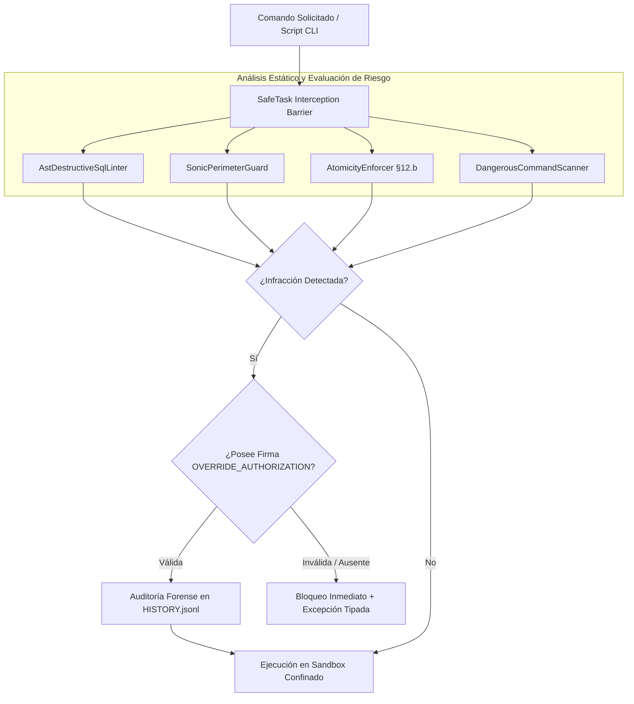

# safe_task: Barrera de Contención y Sandboxing de Tareas Destructivas

## 1. Declaración de Misión y Filosofía
El Skill `safe_task` implementa la **Barrera de Contención y Sandboxing Preventivo** para la ejecución de comandos y tareas operativas dentro del ecosistema de la flota. Su propósito primordial es erradicar fallos catastróficos causados por ejecuciones desatendidas o comandos de IA que intenten mutar esquemas de datos sin migraciones auditadas, ejecutar comandos de purga recursiva (`rm -rf`, `DROP DATABASE`), violar el Perímetro Sónico de la flota (§2) o exceder los topes de atomicidad (§12.b).

Actúa como compuerta pre-flight mandatoria antes de ejecutar cualquier subproceso sensible en el CLI o worker desatendido (`vibraframe-worker`).

---

## 2. Topología y Flujo de Intercepción



---

## 3. Especificación Formal de Interfaces (TypeScript Contracts)

```typescript
export type CommandRiskLevel = 'LOW' | 'MEDIUM' | 'HIGH' | 'CATASTROPHIC';

export interface DestructiveCommandFinding {
  readonly ruleId: string;
  readonly commandSegment: string;
  readonly riskLevel: CommandRiskLevel;
  readonly rationale: string;
  readonly lineIndex?: number;
}

export interface SafeTaskAuditConfig {
  readonly enforceZeroDestructiveSql: boolean;
  readonly enforceSonicPerimeter: boolean;
  readonly maxFileTouchLimit: number;
  readonly allowSignedOverride: boolean;
  readonly dryRunOnly: boolean;
}

export interface CommandInterceptionResult {
  readonly isAllowed: boolean;
  readonly riskLevel: CommandRiskLevel;
  readonly findings: DestructiveCommandFinding[];
  readonly overrideAuthorized: boolean;
  readonly overrideReason?: string;
  readonly executionTimestamp: string;
}

export interface ISafeTaskBarrier {
  evaluateCommand(rawCommandLine: string, config: SafeTaskAuditConfig): Promise<CommandInterceptionResult>;
  auditSqlScript(sqlContent: string): Promise<DestructiveCommandFinding[]>;
  verifySonicPath(targetPath: string): Promise<boolean>;
}
```

---

## 4. Herramientas y Scripts Ejecutables (`scripts/`)

* **Punto de Entrada Primario**: `.agents/skills/safe_task/scripts/safe_task_barrier.dart`
* **Entrypoint Alternativo**: `dart run lib/src/governance/ast_destructive_sql_linter.dart`
* **Entorno**: Dart SDK / Pure Dart (Agnóstico, Multi-OS vía `PlatformGuard`).

### Modos de Operación CLI

#### 1. Intercepción y Validación de Comando de Sistema
```bash
dart run .agents/skills/safe_task/scripts/safe_task_barrier.dart \
  --intercept \
  --command="rm -rf /workspace/data" \
  --strict \
  --json
```

#### 2. Auditoría AST contra Sentencias SQL Destructivas (§4)
```bash
dart run .agents/skills/safe_task/scripts/safe_task_barrier.dart \
  --audit-sql \
  --file="lib/src/datasources/schema_update.sql" \
  --disallow-drop-table
```

#### 3. Ejecución Excepcional con Firma Autenticada
```bash
dart run .agents/skills/safe_task/scripts/safe_task_barrier.dart \
  --intercept \
  --command="git reset --hard HEAD~1" \
  --override-authorization="OVERRIDE_AUTHORIZATION: Remediacion de commit fallido autorizada por PO"
```

### Tabla Determinista de Códigos de Salida
| Código | Estado | Significado Técnico |
| :---: | :--- | :--- |
| `0` | `COMMAND_APPROVED` | Operación segura y confinada dentro de parámetros constitucionales. |
| `1` | `DESTRUCTIVE_COMMAND_VETO` | Veto por comando destructivo (`DROP TABLE`, `rm -rf`, purge). |
| `2` | `SONIC_PERIMETER_VIOLATION`| Intento de acceso a directorios foráneos fuera del búnker (§2). |
| `3` | `ATOMICITY_EXCEEDED` | Mutación de más de 5 archivos en una sola transacción (§12.b). |
| `4` | `INVALID_OVERRIDE_SIGNATURE`| Firma de override malformada o rechazada por falta de motivo. |

---

## 5. Especificaciones de Tests Unitarios y Certificación Física (`test/`)

La certificación física de la barrera de seguridad comprueba la intercepción de forma estricta (§4, §6):
- **Happy Path 1 (Comando Seguro)**: Comandos de lectura o comprobación (`logix check`, `dart test`) reciben autorización con código `0`.
- **Happy Path 2 (Bypass Válido con Firma)**: Comando destructivo acompañado de firma estricta `OVERRIDE_AUTHORIZATION` es autorizado y auditado.
- **Sad Path 1 (§6 con throwsA)**: Invocación de `DROP TABLE` sin migración ni firma arroja `DestructiveCommandVetoException`.
- **Sad Path 2 (§6 con throwsA)**: Intento de operar sobre ruta `/home/opc/code/foraneo` arroja `SonicPerimeterViolationException`.

---

## 6. Paridad Multi-OS y Perímetro Sónico
- **PlatformGuard**: Normalización obligatoria de rutas y separadores antes de la validación del perímetro sónico.
- **Tolerancia Cero a Comandos Fantasma**: Cualquier orden de consola que pretenda eludir el registro histórico o el logging en `HISTORY.jsonl` es terminantemente vetada.
