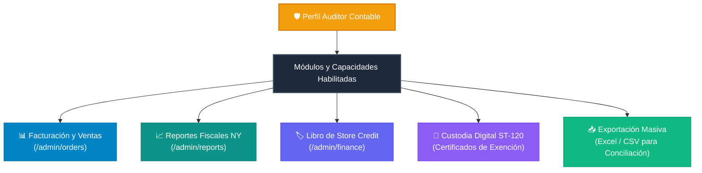

# Guía Profesional del Perfil Auditor Contable y Financiero
## Jhoanes Bakery B2B Platform (`app.jhoanes.com`)

* **Código de Documento:** `MAN-AUD-001`
* **Versión:** `2.0.0` (Enfoque Especializado en Capacidades Financieras)
* **Audiencia:** Contadores, Auditores Externos, Asesores Fiscales NYS DTF y Dirección Financiera.

---

## 1. Propósito y Alcance del Perfil

El perfil de **Auditor Contable y Financiero** en Jhoanes Bakery provee un entorno centralizado y transparente para la supervisión fiscal, análisis de ingresos, conciliación de pagos y auditoría de ventas mayoristas.

Este perfil pone a disposición del equipo contable todas las herramientas requeridas para realizar revisiones periódicas, cierres contables mensuales y la preparación de declaraciones fiscales para el Departamento de Impuestos y Finanzas del Estado de Nueva York (NYS DTF).

---

## 2. Herramientas y Módulos Habilitados

### Resumen de Capacidades Disponibles

| Módulo | Alcance de Información | Herramientas Principales |
| :--- | :--- | :--- |
| **Facturación y Ventas** | Consulta histórica y en tiempo real de todos los pedidos mayoristas. | Búsqueda por cliente, filtros por estado de pago, inspección de desglose fiscal por orden. |
| **Reportes Fiscales** | Resumen agregado de ventas y recaudación de impuestos de Nueva York. | Filtros por rango de fechas, discriminación de ventas gravables vs. exentas. |
| **Libro de Store Credit** | Registro del pasivo corriente por saldos a favor de clientes y vouchers. | Historial de emisiones, saldo redimido en compras y balance pendiente por cliente. |
| **Certificados ST-120** | Registro documental de clientes mayoristas con estatus de exención fiscal. | Visualización de formularios de reventa aprobados y verificación de firma digital. |
| **Exportación Contable** | Generación de libros de ventas normalizados para software contable. | Descargas en `.xlsx` y `.csv` compatibles con QuickBooks, Excel y ERPs. |

---

## 3. Navegación e Inspección en el Panel

### 3.1 Menú Lateral Especializado
Al ingresar a la plataforma, el panel lateral presenta una interfaz simplificada y enfocada exclusivamente en el área contable:
* **📊 Facturación y Ventas** (`/admin/orders`)
* **📈 Reportes Fiscales** (`/admin/reports`)
* **🏷️ Libro de Store Credit** (`/admin/finance`)
* Distintivo visual en cabecera: `🛡️ Auditor Contable / Finanzas`.

### 3.2 Desglose Financiero por Pedido
En la vista de cada orden se presenta una ficha contable estructurada con los siguientes componentes:
* **Subtotal Bruto:** Suma del valor de los productos solicitados al precio pactado.
* **Descuentos Comerciales:** Bonificaciones por volumen o descuentos de empaque aplicados.
* **Base Gravable (Taxable Amount):** Importe neto sujeto a la tasa de impuestos del Estado de Nueva York.
* **Sales Tax NY (8.875%):** Impuesto de venta calculado y recaudado en órdenes no exentas.
* **Insignia ST-120:**
  * `ST-120 EXENTO (0% TAX)`: Cliente mayorista con certificado de reventa validado ante NYS DTF.
  * `GRAVABLE NY (8.875% TAX)`: Cliente que tributa bajo la tasa estándar de Nueva York.
* **Saldo a Favor Redimido (Store Credit):** Deducción comercial aplicada en checkout desde el saldo acumulado del cliente.
* **Total Facturado:** Valor final exigible al cliente.
* **Detalle del Método de Cobranza:**
  * Tarjetas de crédito/débito procesadas vía Stripe.
  * Transferencias bancarias Zelle con código de confirmación.
  * Cheques comerciales B2B con fotografía de respaldo y fecha de vencimiento acordada.
  * Store Credit directo en cuenta.

---

## 4. Guía de Exportación del Libro de Ventas

El sistema permite descargar de forma ágil el libro de ventas completo para su incorporación directa en hojas de trabajo contables o auditorías fiscales:

1. Ingrese a **📊 Facturación y Ventas** (`/admin/orders`) o a **📈 Reportes Fiscales** (`/admin/reports`).
2. Utilice los selectores de fecha superiores para delimitar el período requerido (ej. `01/11/2026` al `30/11/2026`).
3. Opcionalmente, aplique filtros por método de cobranza o condición de pago (`Pagado`, `Pendiente`, `Cheque en Custodia`).
4. Presione el botón **📥 Exportar Libro Fiscal (Excel/CSV)**.
5. El archivo generado incluye los siguientes campos estandarizados:
   * `Order_ID`: Número de orden único en la plataforma.
   * `Date`: Fecha y hora de emisión del pedido.
   * `Customer_Name`: Razón social o nombre comercial del cliente.
   * `Tax_ID_EIN`: Número de identificación tributaria (EIN / Tax ID).
   * `Tax_Status`: Calificación fiscal del cliente (`EXEMPT_ST120` o `TAXABLE_NY`).
   * `Gross_Subtotal`: Subtotal antes de deducciones.
   * `Discounts`: Descuentos comerciales otorgados.
   * `Net_Taxable_Base`: Base neta gravable.
   * `Sales_Tax_NY`: Importe de impuesto de ventas liquidado (8.875%).
   * `Store_Credit_Applied`: Monto descontado mediante saldo a favor.
   * `Total_Billed`: Importe total facturado.
   * `Payment_Method`: Modalidad de pago utilizada.
   * `Payment_Status`: Estado de liquidación del pago.

---

## 5. Auditoría del Pasivo por Store Credit

En el módulo **🏷️ Libro de Store Credit** (`/admin/finance`), el auditor puede dar seguimiento a los saldos a favor otorgados como cortesía o compensación comercial:
* **Balance Total en Circulación:** Pasivo corriente acumulado exigible en futuras compras.
* **Historial por Voucher:** Código canónico (`SC-YYYY-XXXX`), cliente beneficiario, fecha de emisión y estado (`Disponible` o `Redimido`).
* **Relación con Nuevas Órdenes:** Trazabilidad de en qué nuevo pedido se aplicó el saldo, facilitando la conciliación entre el pasivo liquidado y el nuevo ingreso reconocido.

---

## 6. Soporte y Consultas

Para la creación de nuevos usuarios contables, solicitud de campos adicionales en los reportes de exportación o soporte sobre el acceso:
* **Correo de Contacto:** `admin@jhoanes.com`
* **Portal de Acceso:** [app.jhoanes.com](https://app.jhoanes.com)
