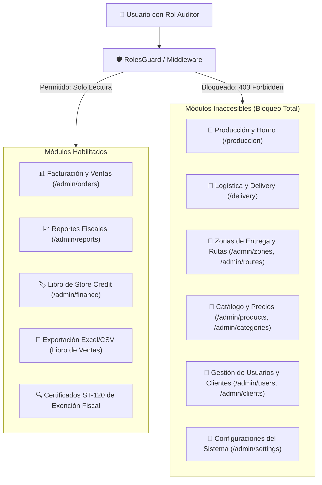

# Manual Operativo y Guía de Seguridad: Rol de Auditor Contable y Financiero
## Jhoanes Bakery B2B Platform (`app.jhoanes.com`)

* **Código de Documento:** `MAN-AUD-001`
* **Versión:** `1.0.0` (Revisión SoD — Segregación de Funciones)
* **Fecha de Emisión:** Noviembre 2026
* **Audiencia:** Auditores Externos, Contadores, Asesores Fiscales NYS DTF y Equipo de Finanzas.

---

## 1. Propósito y Marco de Segregación de Funciones (SoD)

El rol de **Auditor Contable y Financiero (`auditor`)** ha sido diseñado bajo los estándares más estrictos de **Segregación de Funciones (Separation of Duties - SoD)** y control interno contable. 

Su propósito primordial es dotar al equipo de contabilidad y a auditores externos de un acceso integral a los libros de ventas, reportes fiscales del estado de Nueva York y conciliación de cobranzas, **garantizando la imposibilidad técnica de alterar la operación diaria, modificar pedidos, cambiar precios o alterar datos de clientes**.

> [!IMPORTANT]
> **Inviolabilidad Operativa (Read-Only SoD):**
> El rol `auditor` opera bajo una política de **Solo Lectura Estricta**. Cualquier intento de ejecutar mutaciones en el sistema (creación, edición, eliminación o cambio de estado de pedidos, productos, rutas o usuarios) es rechazado automáticamente a nivel de protocolo con un error **`403 Forbidden`**.

---

## 2. Matriz de Permisos y Perímetro de Acceso

### Tabla Comparativa de Permisos por Rol

| Módulo / Acción | Admin | Auditor | Chofer / Delivery | Cliente B2B |
| :--- | :---: | :---: | :---: | :---: |
| **Ver Órdenes y Facturación** | ✅ Total | 👁️ Solo Lectura | 👁️ Solo sus rutas | 👁️ Solo sus órdenes |
| **Exportar Libro de Ventas (Excel/CSV)** | ✅ Sí | ✅ Sí | ❌ No | ❌ No |
| **Consultar Desglose Fiscal NY (8.875%)** | ✅ Sí | ✅ Sí | ❌ No | 👁️ En su invoice |
| **Descargar Certificados ST-120** | ✅ Sí | ✅ Sí | ❌ No | 👁️ Solo el propio |
| **Ver Libro de Store Credit (Saldo a Favor)** | ✅ Total | 👁️ Solo Lectura | ❌ No | 👁️ Solo su balance |
| **Aprobar / Cancelar Pedidos** | ✅ Sí | 🚫 403 Forbidden | ❌ No | ❌ No |
| **Modificar Precios o Catálogo** | ✅ Sí | 🚫 403 Forbidden | ❌ No | ❌ No |
| **Acceder a Producción / Despacho** | ✅ Sí | 🚫 Redirección 307 | ❌ No | ❌ No |

---

## 3. Experiencia de Usuario y Navegación

Al iniciar sesión con credenciales de auditor:

1. **Sidebar de Navegación Aislado**:
   - En el panel lateral únicamente se mostrarán los tres accesos contables:
     - **📊 Facturación y Ventas** (`/admin/orders`)
     - **📈 Reportes Fiscales** (`/admin/reports`)
     - **🏷️ Libro de Store Credit** (`/admin/finance`)
   - Se muestra permanentemente la insignia visual:  
     `🛡️ Auditor Contable / Finanzas`

2. **Panel de Facturación y Órdenes (`/admin/orders`) en Modo Read-Only**:
   - Se despliega el banner superior informativo:  
     `🛡️ MODO AUDITOR CONTABLE (READ-ONLY SoD): Acceso habilitado exclusivamente para inspección financiera, conciliación fiscal y exportación.`
   - Los botones operativos de mutación (*Cancelar pedido*, *Cambiar a Listo*, *Entregado*, *Reembolsar*, *Eliminar ítem*) se encuentran **completamente ocultos y suprimidos del DOM**.
   - Se habilita la vista de auditoría con el desglose exacto de:
     - **Base Gravable (Taxable Amount)**.
     - **Sales Tax NY recaudado (8.875%)**.
     - **Estatus de exención fiscal ST-120** (`ST-120 EXENTO (0% TAX)` vs `GRAVABLE NY (8.875%)`).
     - **Descuentos comerciales o de empaque**.
     - **Compensación aplicada por Store Credit** (Saldo a favor).
     - **Método de pago** (Stripe Tarjeta, Transferencia Zelle, Cheque B2B o Saldo en Cuenta).

3. **Protección Perimetral de Rutas (Middleware)**:
   - Si el auditor intenta ingresar manualmente por barra de direcciones a una ruta operativa (ej. `app.jhoanes.com/produccion` o `app.jhoanes.com/admin/settings`), el sistema ejecuta una redirección inmediata (`HTTP 307`) hacia `/admin/orders` con un toast de alerta de seguridad:  
     `⚠️ Acceso restringido: El rol de auditor solo tiene autorización para consultas contables y de facturación.`

---

## 4. Guía Paso a Paso: Exportación del Libro de Ventas y Conciliación Fiscal

Para extraer la información requerida en cierres de mes o declaraciones ante el Departamento de Impuestos y Finanzas del Estado de Nueva York (NYS DTF):

1. Diríjase a **📊 Facturación y Ventas** o a **📈 Reportes Fiscales**.
2. En la barra superior, seleccione el **Rango de Fechas** deseado (ej. `01/11/2026` al `30/11/2026`).
3. Filtre opcionalmente por estado financiero (`Todos`, `Pagado`, `Pendiente de Cobro`, `Cheque en Revisión`).
4. Haga clic en el botón verde **📥 Exportar Libro Fiscal (Excel/CSV)**.
5. El sistema descargará un archivo `.xlsx` estructurado con las siguientes columnas contables normalizadas:
   - `Order_ID`: Identificador único de pedido.
   - `Date`: Fecha y hora de creación y despacho.
   - `Customer_Name` y `Customer_Tax_ID`: Razón social y EIN/Tax ID del cliente mayorista.
   - `Tax_Status`: `EXEMPT (ST-120)` o `TAXABLE_NY`.
   - `ST120_Certificate_Hash`: Hash SHA-256 del certificado ST-120 aprobado en custodia digital.
   - `Gross_Subtotal`: Subtotal bruto antes de descuentos.
   - `Discounts_Applied`: Descuentos de volumen o empaque.
   - `Net_Taxable_Base`: Base gravable neta sujeta a impuesto.
   - `Sales_Tax_NY_8_875`: Impuesto de ventas liquidado.
   - `Store_Credit_Redeemed`: Descuento comercial por saldo a favor (sin impacto fiscal en invoice).
   - `Total_Billed`: Importe total facturado.
   - `Payment_Method`: `STRIPE_CC`, `ZELLE_TRANSFER`, `B2B_CHECK`, `STORE_CREDIT`.
   - `Payment_Status`: `PAID`, `PENDING_CLEARANCE`, `OVERDUE`.

---

## 5. Preguntas Frecuentes y Soporte

* **¿Puede un auditor modificar una orden por solicitud de un cliente?**  
  *No.* El principio SoD lo prohíbe técnicamente. Cualquier ajuste físico en pedidos debe ser ejecutado por el personal de Administración con rol `admin`.
* **¿Qué sucede si un cliente afirma estar exento de impuestos pero la orden cobró Tax?**  
  El auditor puede consultar en la orden el badge ST-120. Si el certificado no fue cargado o se encuentra en estado `PENDING` / `REJECTED`, el sistema aplica por normativa fiscal de NY el 8.875%. Una vez que Administración valida el formulario ST-120 físico, las órdenes subsiguientes se emiten a tasa 0%.
* **¿Dónde solicitar asistencia de credenciales?**  
  Contacte al Administrador del Bunker vía correo a `admin@jhoanes.com`.
