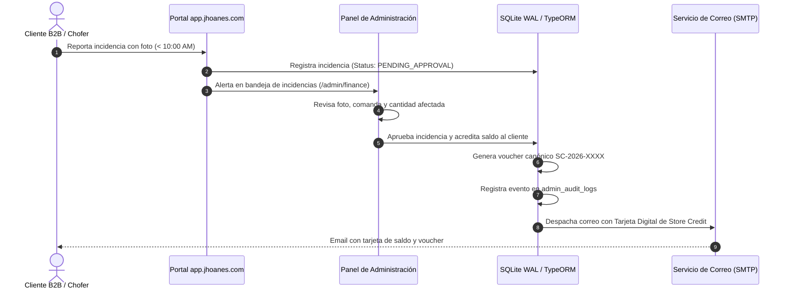

# Manual Operativo para Administración: Gestión de Incidencias, Emisión de Store Credit y Conciliación Contable
## Jhoanes Bakery B2B Platform (`app.jhoanes.com`)

* **Código de Documento:** `MAN-ADM-003`
* **Versión:** `2.0.0` (Modelo Saldo a Favor / SoD Contable)
* **Fecha de Emisión:** Noviembre 2026
* **Audiencia:** Administradores del Sistema, Gerencia de Operaciones, Encargados de Despacho y Finanzas.

---

## 1. Fundamentos y Políticas de Gobernanza

### 1.1 Principio Rector: Retención de Valor y Desvinculación Fiscal
La gestión de devoluciones, faltantes y mercancía dañada en Jhoanes Bakery se rige por dos políticas inquebrantables de control interno:

1. **Cero Reembolsos Monetarios (Retención de Liquidez):**  
   Bajo ninguna circunstancia se ejecutan transferencias bancarias de reintegro ni reversos en pasarelas de pago (Stripe). Toda compensación se otorga como **Saldo a Favor (Store Credit)** en la cuenta digital del cliente. Esto protege el flujo de caja, evita dobles comisiones por procesamiento y garantiza que el volumen de venta permanezca dentro de Jhoanes Bakery.

2. **Inmutabilidad de Facturas Originales (No Notas de Crédito):**  
   La factura (`Invoice`) de la orden original permanece **100% inalterada**. No se emiten notas de crédito fiscales que descuadren el reporte mensual de impuestos ante el Departamento de Impuestos y Finanzas de Nueva York (NYS DTF). El Store Credit emitido se concilia contablemente como un pasivo corriente (anticipo comercial de clientes) y se aplica como deducción en el checkout de la orden subsiguiente.

---

## 2. Flujo de Trabajo Administrativo (Workflow)

---

## 3. Criterios de Evaluación y Aprobación de Incidencias

Antes de autorizar la emisión de Store Credit, el administrador debe verificar:

| Criterio | Parámetro Exigido | Acción en caso de Incumplimiento |
| :--- | :--- | :--- |
| **Ventana Horaria** | Reporte emitido antes de las **10:00 AM** del día de entrega. | Si el reporte es posterior a las 10:00 AM, el sistema advierte extemporaneidad. Requiere justificación excepcional escrita. |
| **Evidencia Fotográfica** | Foto nítida del producto dentro de su caja/bandeja, o foto de comanda física con tachadura y firma. | Rechazar reporte con nota: *"Evidencia fotográfica insuficiente o ilegible"*. |
| **Cotejo con Despacho** | Verificar en hoja de ruta si el chofer anotó la novedad o si cocina reportó faltante matutino. | Si el chofer reportó entrega conforme firmada, contactar telefónicamente al cliente para aclarar discrepancia. |
| **Historial del Cliente** | Evaluar tasa histórica de incidencias del cliente (< 3% promedio admisible). | Si el cliente presenta incidencias recurrentes (> 10% de sus pedidos), escalar a Gerencia Comercial para inspección de ruta. |

---

## 4. Procedimiento de Emisión y Acreditación Paso a Paso

1. Ingrese a [app.jhoanes.com/admin/finance](https://app.jhoanes.com/admin/finance) con sus credenciales de Administrador.
2. Diríjase a la pestaña **"Gestión de Incidencias y Store Credit"** (o ubique la orden en `/admin/orders`).
3. En la tabla de incidencias pendientes, haga clic en el botón **"Revisar"**:
   - Se abrirá el modal con los datos del pedido, producto afectado, cantidad solicitada y la fotografía ampliada de evidencia.
4. **Validación del Monto**:
   - El sistema calcula automáticamente el valor a compensar según el precio pactado del ítem en la fecha de la orden:
     $$\text{Monto SC} = \text{Cantidad Dañada/Faltante} \times \text{Precio Unitario Facturado}$$
   - El administrador puede ajustar el importe en caso de compensaciones de cortesía autorizadas.
5. **Confirmación y Emisión**:
   - Haga clic en el botón verde **"Aprobar y Emitir Store Credit"**.
6. **Efectos Automáticos Ejecutados por el Sistema**:
   - Se genera el código de voucher canónico: `SC-YYYY-XXXX` (ej. `SC-2026-0042`).
   - El balance `store_credit_balance` del usuario se incrementa en disco de manera atómica.
   - El estado de la incidencia cambia a `APPROVED`.
   - Se dispara en segundo plano el envío del correo electrónico al cliente con la tarjeta digital de Store Credit.
   - Se crea una entrada inmutable en `admin_audit_logs` registrando el `admin_id`, fecha, monto y hash de la transacción.

---

## 5. Procedimiento para Emisión Manual de Saldo de Cortesía

En situaciones excepcionales donde se acuerde una bonificación comercial directa (ej. demora logística severa):

1. En `/admin/finance`, haga clic en el botón azul **"Nueva Tarjeta de Saldo a Favor"**.
2. Seleccione el cliente mayorista destinatario mediante el buscador predictivo.
3. Ingrese el monto en dólares a acreditar.
4. En el campo **Motivo Obligatorio**, redacte la justificación comercial (ej. *"Cortesía por retraso involuntario de 45 min en ruta Queens 17-Nov"*).
5. Haga clic en **"Crear y Enviar Saldo"**.
6. El cliente recibirá su tarjeta digital y el saldo estará disponible para su siguiente compra.

---

## 6. Conciliación y Tratamiento Contable del Store Credit

### 6.1 Naturaleza en el Balance General
El Store Credit emitido **NO es un gasto ni una pérdida en el momento de su emisión**. Representa un pasivo corriente:
* **Cuenta Contable:** `2100 - Anticipos de Clientes / Pasivo por Saldo a Favor (Customer Deposits)`.
* **Al momento de emitir SC:** Se reconoce el pasivo a favor del cliente contra la cuenta de ajuste operativo correspondiente.
* **Al momento de redimir en una nueva compra:** El pasivo se cancela y se reconoce el ingreso de la nueva orden (`Revenue`), tributando el impuesto de venta (Sales Tax) exclusivamente sobre la base imponible real resultante tras el descuento.

### 6.2 Reportes de Auditoría Disponibles
El administrador y el auditor financiero pueden consultar en `/admin/finance`:
* **Libro Mayor de Store Credit:** Total emitido, total redimido en compras y pasivo pendiente exigible al cierre de cada mes.
* **Trazabilidad por Cliente:** Extracto detallado de cada movimiento (créditos y débitos por orden).
* **Exportación Excel:** Listado completo de vouchers con fecha de caducidad y estado de utilización.
