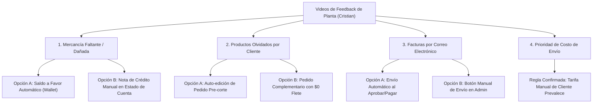

# Decisiones de Negocio Pendientes — Operación y Planta B2B
> **Proyecto**: Jhoanes Bakery Wholesale (`pj-air`)  
> **Fecha**: 2026-11-06  
> **Origen**: Retroalimentación Operativa y Videos de Planta (Cristian & Equipo)  
> **Estado**: En Espera de Arbitraje del Product Owner (PO)

---

## Contexto Operativo
Durante las pruebas de ciclo completo en el entorno de testing (`testing.jhoanes.com`), el equipo de operaciones en planta (Cristian) planteó cuatro casos de uso recurrentes en la logística diaria de panadería mayorista.

El presente documento resume las opciones técnicas y operativas para cada caso, con el fin de definir la regla de negocio oficial antes de proceder con el siguiente sprint.

---



---

## 1. Mercancía Dañada o Faltante (Aplicación del Crédito)

### Caso de Uso
Un cliente mayorista paga su pedido por adelantado vía Zelle o Tarjeta. Al momento de la entrega física, algunos productos llegan partidos o la entrega fue parcial. Cristian edita la orden en `/admin/orders` y reduce las cantidades. La administración **no realiza devoluciones en efectivo ni reversos por Zelle**.

### Opciones de Negocio

| Criterio | Opción A: Saldo a Favor Automático *(Recomendada)* | Opción B: Nota de Crédito Contable |
| :--- | :--- | :--- |
| **Mecanismo** | Se acredita el saldo diferencial a una bolsa de saldo a favor (`store_credit`) en el perfil del cliente. | Se emite un registro contable de "Nota de Crédito" en el Estado de Cuenta B2B. |
| **Aplicación** | En su siguiente compra en la web, el sistema le descuenta **automáticamente** ese saldo del total a pagar. | El saldo se compensa manualmente al emitir o cobrar la factura global del mes. |
| **Experiencia Cliente** | Visualiza su saldo disponible en el Navbar y Checkout; proceso transparente y sin fricción. | Requiere que el cliente hable con Cristian o administración para acordar el descuento. |
| **Impacto Operativo** | Cero conciliación manual para Cristian. | Requiere ajuste manual en cada pedido posterior. |

> [!TIP]
> **Recomendación Técnica**: La **Opción A** elimina la fricción telefónica y evita errores humanos al momento de cobrar el siguiente pedido.

---

## 2. Cliente que Olvidó Agregar Productos al Pedido

### Caso de Uso
Un cliente mayorista ya cerró y pagó su orden para entrega el viernes. Horas después nota que olvidó pedir 2 cajas de Croissants para esa misma fecha de entrega.

### Opciones de Negocio

| Criterio | Opción A: Auto-edición Pre-Corte | Opción B: Pedido Complementario ($0 Flete) *(Recomendada)* |
| :--- | :--- | :--- |
| **Mecanismo** | El cliente puede pulsar "Modificar Pedido" en su portal hasta las 12:00 PM ET del día previo a producción. | El cliente genera un nuevo pedido normal seleccionando la misma fecha de entrega. |
| **Pago Adicional** | El sistema cobra la diferencia del subtotal adicional. | Se cobra únicamente el monto de los nuevos productos sin recargo de envío. |
| **Logística de Planta** | Modifica la orden existente, lo que puede causar confusiones si Cristian ya imprimió la hoja de cocina preliminar. | Crea una segunda orden identificada como `Complementaria #...`, sumándose a la misma ruta de despacho. |
| **Regla de Envío** | No aplica flete adicional. | El sistema detecta que ya tiene una orden activa para esa fecha y coloca `delivery_fee = $0.00`. |

> [!IMPORTANT]
> Si se elige la **Opción A**, toda modificación realizada después de las 12:00 PM ET queda estrictamente bloqueada por el corte de producción.

---

## 3. Despacho de Facturas por Correo Electrónico

### Caso de Uso
Cristian consultó si la factura contable oficial le llega al cliente directamente a su buzón de correo.

### Opciones de Negocio

* **Opción A — Envío Automático**: En cuanto una orden pasa a estado `Aprobada` o `Pagada` (tras conciliar Zelle, aprobar cheque o cobrar en Stripe), el backend genera el PDF de la factura en inglés y lo envía automáticamente al correo del cliente.
* **Opción B — Envío Manual Asistido**: Se incorpora un botón visible `"📧 Enviar Factura por Email"` en el panel `/admin/orders/[id]` para que Cristian decida cuándo despacharla.
* **Opción C — Híbrida**: Envío automático por defecto + botón manual para reenvíos en caso de que el cliente no la encuentre en su bandeja.

---

## 4. Prioridad en la Tarifa de Envío (Delivery Fee)

### Caso de Uso
El sistema calcula el costo de envío automáticamente mediante millaje vial desde la panadería en Astoria (ej. \$40). Sin embargo, en la ficha del cliente en `/admin/clients`, Cristian puede configurar un costo de envío personalizado (ej. \$30 o \$60).

### Regla Propuesta para Validación
Confirmar si la jerarquía definitiva debe ser:

1. **Prioridad 1 (Tarifa Personalizada)**: Si el cliente tiene un valor configurado en su perfil (`user.delivery_fee >= 0`), **este monto prevalece sobre cualquier cálculo automático**.
2. **Prioridad 2 (Cálculo por Millaje)**: Si el perfil tiene el campo vacío o en `null`, se aplica la matriz de distancia (Astoria -> Destino).
3. **Prioridad 3 (Pick Up)**: Si el cliente selecciona retiro en tienda, el flete es siempre \$0.00.

---

## Formulario Rápido de Respuesta

Puedes responder a este documento indicando tu selección directa:

```text
1. Mercancía dañada/faltante: [ Opción A (Saldo en cuenta) | Opción B (Nota contable) ]
2. Pedidos olvidados:        [ Opción A (Auto-edición) | Opción B (Pedido adicional $0 fee) ]
3. Factura por correo:       [ Opción A (Automático) | Opción B (Manual) | Opción C (Híbrido) ]
4. Prioridad Delivery Fee:   [ Confirmado | Ajustar regla ]
```
