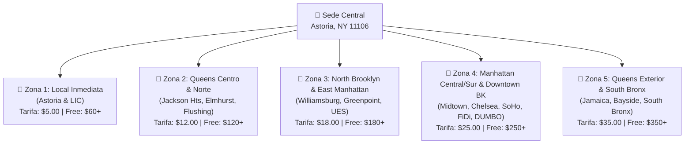

# Propuesta Logística de Zonas de Entrega y Envío Gratis (Free Delivery)
## Jhoanes Bakery & Wholesale — Ciudad de Nueva York

> **Sede Central de Operaciones (Punto de Origen)**:  
> **33-04 Broadway, Astoria, NY 11106** (Queens, New York)  
> **Teléfono de Soporte**: (347) 408-7024  
> **Área Metropolitana Cubierta**: Queens, Brooklyn, Manhattan y South Bronx.

---

## 1. Fundamento y Estructura del Modelo

La distribución mayorista y de reparto directo de **Jhoanes Bakery** se estructura de manera concéntrica a partir de la sede física en Astoria. Este modelo optimiza los tiempos de entrega, considera la geografía de cruces viales sin peajes (puentes Queensboro y Pulaski) frente a zonas de alta congestión comercial, e incentiva compras de mayor volumen mediante **Envío Gratis (Free Delivery)** automatizado.

---

## 2. Matriz Detallada de Zonas y Códigos Postales (ZIP Codes)

A continuación se detalla la parametrización de las **5 zonas concéntricas** que cubren **72 códigos postales únicos**:

### 🟢 Zona 1: Local Inmediata (Astoria, Ditmars & LIC)
* **Radio**: 0 – 3 millas de la panadería.
* **Barrios incluidos**: Astoria, Ditmars Steinway, Long Island City, Sunnyside, Woodside, Hunters Point.
* **Tarifa Base**: **$5.00**
* **Mínimo de Compra para Envío Gratis**: **$60.00**
* **Códigos Postales (8 ZIPs)**:
  `11101, 11102, 11103, 11104, 11105, 11106, 11109, 11377`
* **Ventaja Operativa**: Reparto ágil y de proximidad en bicicleta/moto o van local sin cruce de puentes.

---

### 🟡 Zona 2: Queens Centro y Norte
* **Radio**: 3 – 6 millas.
* **Barrios incluidos**: Jackson Heights, Elmhurst, East Elmhurst, Corona, Forest Hills, Rego Park, Maspeth, Middle Village, Ridgewood, Flushing, College Point.
* **Tarifa Base**: **$12.00**
* **Mínimo de Compra para Envío Gratis**: **$120.00**
* **Códigos Postales (13 ZIPs)**:
  `11354, 11355, 11356, 11368, 11369, 11370, 11372, 11373, 11374, 11375, 11378, 11379, 11385`
* **Ventaja Operativa**: Corredor comercial continuo en Queens, sin pago de peajes.

---

### 🟠 Zona 3: North Brooklyn & East Manhattan
* **Radio**: 3 – 7 millas (cruce fluvial inmediato).
* **Barrios incluidos**:
  * **North Brooklyn** (acceso directo por Pulaski Bridge): Greenpoint, Williamsburg, Bushwick.
  * **Manhattan Este & Roosevelt Island** (cruce por Queensboro Bridge): Roosevelt Island, Upper East Side, Lenox Hill, Midtown East, Murray Hill.
* **Tarifa Base**: **$18.00**
* **Mínimo de Compra para Envío Gratis**: **$180.00**
* **Códigos Postales (13 ZIPs)**:
  `10016, 10017, 10021, 10022, 10028, 10044, 10065, 10075, 11206, 11211, 11222, 11237, 11249`
* **Ventaja Operativa**: Conexión directa hacia zonas con alta densidad de cafeterías y restaurantes gourmet B2B.

---

### 🔴 Zona 4: Manhattan Central/Sur & Downtown Brooklyn
* **Radio**: 7 – 12 millas.
* **Barrios incluidos**:
  * **Manhattan Oeste y Distrito Financiero**: Midtown West, Chelsea, Hell's Kitchen, Flatiron, Greenwich Village, SoHo, Tribeca, Financial District (FiDi), Lower East Side, Upper West Side.
  * **Brooklyn Central**: Downtown Brooklyn, DUMBO, Brooklyn Heights, Fort Greene, Park Slope, Gowanus, Cobble Hill, Prospect Heights.
* **Tarifa Base**: **$25.00**
* **Mínimo de Compra para Envío Gratis**: **$250.00**
* **Códigos Postales (26 ZIPs)**:
  `10001, 10002, 10003, 10004, 10005, 10006, 10007, 10009, 10010, 10011, 10012, 10013, 10014, 10018, 10019, 10023, 10024, 10025, 10036, 10038, 11201, 11205, 11215, 11217, 11231, 11238`
* **Ventaja Operativa**: Compensa el tiempo de tráfico vehicular y estacionamiento en el corazón de Manhattan y Brooklyn.

---

### 🟣 Zona 5: Queens Exterior & South Bronx
* **Radio**: 10 – 18 millas.
* **Barrios incluidos**:
  * **Queens Este / Sur**: Jamaica, Bayside, Whitestone, Oakland Gardens, Kew Gardens, Richmond Hill, Woodhaven.
  * **South Bronx** (vía RFK Bridge): Mott Haven, Port Morris, Hunts Point.
* **Tarifa Base**: **$35.00**
* **Mínimo de Compra para Envío Gratis**: **$350.00**
* **Códigos Postales (12 ZIPs)**:
  `10451, 10454, 10455, 11357, 11360, 11361, 11364, 11415, 11418, 11421, 11432, 11435`
* **Ventaja Operativa**: Reservado para entregas mayoristas en bloque y restaurantes con pedidos semanales programados.

---

## 3. Comportamiento en la Plataforma Digital

1. **Autodetección en Tiempo Real en Checkout**:
   * En cuanto el cliente selecciona su dirección registrada o tipea una nueva dirección con su ZIP de 5 dígitos (ej. `11105`), la plataforma calcula la tarifa correspondiente al instante.
2. **Incentivo de Venta (Upselling)**:
   * Si la compra del cliente está por debajo del monto mínimo, el checkout muestra una alerta dinámica:  
     *`"Te faltan $18.50 para disfrutar de Envío Gratis en tu zona"`*.
   * Al alcanzar el monto mínimo, la tarifa cambia automáticamente a **$0.00** y se ilumina la insignia verde:  
     *`"🎉 ¡Envío Gratis por compra mayor a $X!"`*.
3. **Retiro en Panadería (Pick Up)**:
   * Siempre que el cliente elija la opción *"Pick Up (Retiro en Panadería Jhoanes - 33-04 Broadway)"*, la tarifa de envío es automáticamente **$0.00**.
4. **Tarifas Especiales VIP**:
   * Si la administración pacta una tarifa especial con un cliente mayorista recurrente (ej. $0.00 o tarifa plana fija), esta se configura en su perfil (`user.delivery_fee`) y prevalece automáticamente sobre la zona general.
5. **Autonomía Administrativa Total**:
   * En el panel [`/admin/zones`](https://testing.jhoanes.com/admin/zones), el administrador puede:
     * Crear nuevas zonas o subdividir las existentes.
     * Modificar las tarifas base o los montos mínimos en cualquier momento con efecto inmediato.
     * Activar o pausar temporalmente cualquier zona sin necesidad de tocar código.

---

## 4. Estado de Validación y Acciones Requeridas por el Cliente

Para el pase final a producción (`app.jhoanes.com`), solicitamos la revisión y visto bueno de los siguientes puntos:

### A. Aprobación de la Matriz de Zonas y Tarifas
* [ ] Confirmar si las 5 zonas y los montos mínimos de compra para envío gratis ($60, $120, $180, $250, $350) se alinean con la estructura de costos y márgenes del negocio.

### B. Registros DNS para Correos Transaccionales (`jhoanes.com`)
* [ ] **Acción en el registrador de dominio (Cloudflare / GoDaddy / Namecheap)**:
  El servidor de correos en el VPS está listo para enviar confirmaciones, facturas y recibos desde `pedidos@jhoanes.com`. Se requiere agregar 2 registros TXT en su panel DNS para evitar que los correos caigan en SPAM:
  1. **SPF**: `TXT` `@` -> `v=spf1 ip4:187.124.67.53 ~all`
  2. **DKIM**: `TXT` `mail._domainkey` -> clave pública RSA provista en la guía de DNS.

### C. Validación en el Entorno de Pruebas (`https://testing.jhoanes.com`)
* [ ] **Resolución de videos de feedback (Sprint 38)**:
  * Eliminación del campo "Alias" en direcciones.
  * Obligatoriedad de "Nombre de Empresa" en registro de nuevos clientes.
  * Protección de carrito y estado "Pago Pendiente" al cancelar el modal de pago Stripe.
* [ ] **Nuevas capacidades B2B (Sprints 39, 40 y 41)**:
  * Pago con Zelle y bonificación del 3.5% de cargo de empaque.
  * Detección dinámica de zonas y envío gratis en checkout.
  * Verificación telefónica por SMS OTP en registro y edición de perfil.
