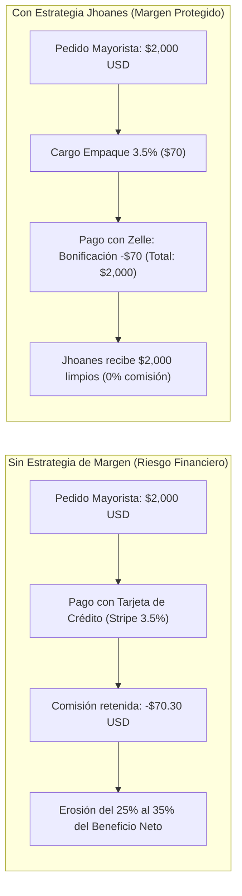
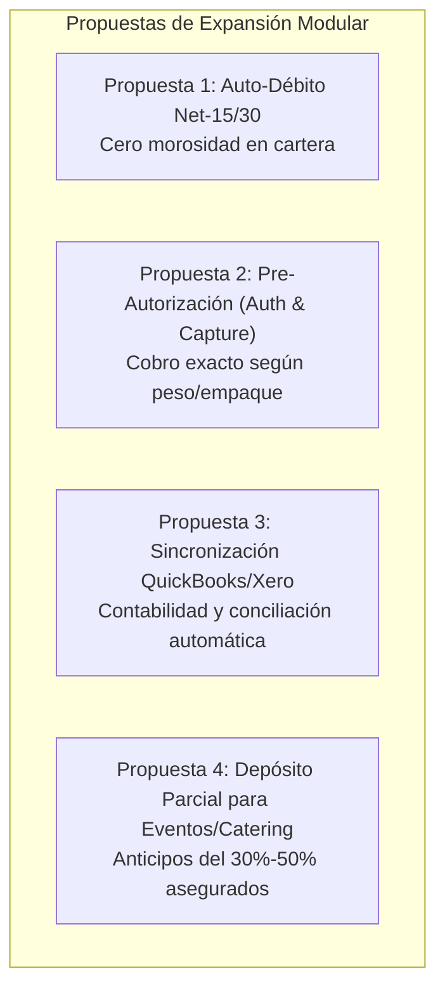

# Estrategia Financiera B2B: Comisiones de Procesamiento Stripe y Preservación de Márgenes Mayoristas
## Jhoanes Bakery & Wholesale — Gestión de Pagos Segura y Rentable

> **Objetivo**: Proteger el margen operativo de panadería al por mayor, evitar fugas de capital por comisiones bancarias en órdenes de alto valor, y ofrecer a los clientes B2B incentivos claros para utilizar canales de bajo costo sin infringir normativas comerciales.

---

## 1. El Desafío Financiero en la Distribución B2B

En el comercio minorista tradicional (retail), los pedidos promedio oscilan entre \$10 y \$25 USD. En ese escenario, una comisión del 3% equivale a centavos y suele absorberse dentro del precio de vitrina.

Sin embargo, en **Jhoanes Wholesale**, el modelo opera con pedidos comerciales recurrentes de restaurantes, cafeterías, bodegas y supermercados, con tickets que van de **\$300 a \$3,000+ USD**.

### Impacto en la Rentabilidad Neta
* Si el margen neto promedio de producción al por mayor es del **15%** (ej. \$150 de ganancia neta en un pedido de \$1,000):
  * Una comisión de pasarela del 3% a 4% representa **ceder entre el 20% y el 27% de la ganancia líquida del negocio**.
  * En un volumen mensual de \$50,000 USD, las comisiones de tarjeta sin blindaje representan entre **\$1,500 y \$2,200 USD mensuales perdidos** en tarifas financieras.

---

## 2. Estructura de Tarifas de Procesamiento en EE.UU.

Stripe aplica la siguiente estructura de comisiones estándar en territorio estadounidense:

| Método de Pago | Comisión de la Pasarela | Costo en Pedido de \$500 | Costo en Pedido de \$1,500 | Costo en Pedido de \$3,000 |
| :--- | :--- | :---: | :---: | :---: |
| **Tarjeta Crédito / Débito Estándar** | 2.9% + \$0.30 USD | **\$14.80** | **\$43.80** | **\$87.30** |
| **Tarjetas Corporativas / AMEX / Int.** | 3.9% a 4.4% + \$0.30 USD | **\$19.80** | **\$58.80** | **\$117.30** |
| **ACH Direct Debit (Débito en Cuenta)** | 0.8% (*Tope máximo de \$5.00*) | **\$4.00** | **\$5.00** (Tope) | **\$5.00** (Tope) |
| **Zelle B2B (Pago Directo Banco a Banco)** | **0.0% (\$0.00 USD)** | **\$0.00** | **\$0.00** | **\$0.00** |
| **Línea de Crédito Comercial B2B** | **0.0% (\$0.00 USD)** | **\$0.00** | **\$0.00** | **\$0.00** |

---

## 3. La Estrategia Implementada en la Plataforma

Para neutralizar este impacto sin perjudicar la experiencia de compra del cliente, se implementó un modelo de **cuatro capas de protección**:

### Capa 1: Cargo por Empaque y Manejo (3.5%) vs. Bonificación por Pago Directo
1. **Configuración en Checkout**:
   * Todo pedido calculado con tarjeta de crédito/débito incluye un concepto transparente de **"Empaque y Manejo Mayorista" (+3.5%)**.
   * Este porcentaje cubre con exactitud el fee de procesamiento de Stripe, eliminando cualquier merma financiera para Jhoanes.
2. **Incentivo por Pago con Zelle (Bonificación del 100%)**:
   * Cuando el cliente selecciona **Zelle**, el sistema aplica una bonificación inmediata en verde:  
     `🎁 Bonificación Pago Directo (Zelle): -$X.XX`.
   * El cliente ve cómo el cargo de empaque se cancela por completo a **\$0.00**.
3. **Cumplimiento Normativo (Estado de Nueva York y FTC)**:
   * En lugar de penalizar al cliente con un "recargo por tarjeta" (*surcharge*, el cual tiene restricciones legales estrictas en varios estados), se utiliza la figura universalmente aprobada de **Descuento por Pago en Efectivo/Directo (*Cash/Direct Payment Discount*)**.
   * El comprador percibe una recompensa por pagar por Zelle, no un castigo por usar tarjeta.

---

### Capa 2: Pasarela Zelle B2B con Verificación en Panel Administrativo
* **Cero Comisiones**: Las transferencias vía Zelle entre cuentas corporativas o comerciales no tienen comisiones de procesamiento.
* **Seguridad y Prevención de Fraude**:
  * El cliente ingresa obligatoriamente el número de referencia o ID de confirmación de su banco.
  * El backend valida que la referencia no haya sido utilizada previamente.
  * **Aislamiento de Producción**: La orden queda registrada con estado `pending_zelle_verification`. **No ingresa al plan de horneado ni a la torre de producción** hasta que el administrador de Jhoanes verifica la acreditación de los fondos en la app bancaria y presiona **"Aprobar Pago"** en `/admin/orders`.

---

### Capa 3: Transferencias Bancarias ACH Direct Debit con Tope de \$5.00
* Para aquellos clientes corporativos que prefieren la comodidad del débito automático sin usar Zelle:
  * Stripe ofrece la pasarela **ACH Direct Debit** (`us_bank_account`).
  * La comisión es de apenas 0.8%, pero cuenta con un **tope fijo de \$5.00 USD por transacción**, sin importar el monto.
  * En una compra de \$2,500 USD:
    * Pago con Tarjeta: Comisión de \$72.80.
    * Pago con ACH: Comisión fija de **\$5.00**.
    * **Ahorro neto para Jhoanes: \$67.80 en una sola orden.**

---

### Capa 4: Cuentas de Crédito B2B Auditadas (Net-15 / Net-30)
* Clientes recurrentes de alta confianza operan bajo una línea de crédito comercial autorizada desde el panel de administración.
* Los pedidos cargados a crédito tienen \$0 de comisión de pasarela en la emisión del pedido.
* Su liquidación posterior se realiza mediante cheque corporativo o transferencia bancaria directa (ACH/Wire/Zelle).

---

## 4. Tabla de Ahorro y Simulación Financiera

Comparativa de ingresos netos para Jhoanes según el método de pago elegido:

| Monto del Pedido | Tarjeta de Crédito (Sin Estrategia) | Tarjeta de Crédito (Con Empaque 3.5%) | Zelle B2B (Recomendado) | ACH Direct Debit |
| :---: | :---: | :---: | :---: | :---: |
| **\$300.00** | Jhoanes recibe: \$291.00 *(Pierde \$9)* | Jhoanes recibe: **\$300.20** | Jhoanes recibe: **\$300.00** | Jhoanes recibe: **\$297.60** |
| **\$800.00** | Jhoanes recibe: \$776.50 *(Pierde \$23.50)* | Jhoanes recibe: **\$800.70** | Jhoanes recibe: **\$800.00** | Jhoanes recibe: **\$795.00** |
| **\$1,500.00** | Jhoanes recibe: \$1,456.20 *(Pierde \$43.80)* | Jhoanes recibe: **\$1,501.50** | Jhoanes recibe: **\$1,500.00** | Jhoanes recibe: **\$1,495.00** *(Cap \$5)* |
| **\$2,500.00** | Jhoanes recibe: \$2,427.20 *(Pierde \$72.80)* | Jhoanes recibe: **\$2,502.50** | Jhoanes recibe: **\$2,500.00** | Jhoanes recibe: **\$2,495.00** *(Cap \$5)* |

> **Proyección Anual**: Para una facturación mayorista de \$40,000 USD mensuales (\$480,000 anuales), canalizar el 75% de las compras hacia Zelle, ACH o compensar mediante el fee de empaque representa un **ahorro neto directo de entre \$11,000 y \$15,000 USD al año**.

---

## 5. Recomendaciones para el Equipo Comercial de Jhoanes

1. **Mensaje Sugerido para Clientes Habituales**:
   > *"Hola [Cliente], para mantener los mejores precios mayoristas de nuestros panes y croissants sin recargos, te recomendamos pagar tus pedidos por Zelle o ACH. Al pagar por Zelle en la plataforma, el cargo de empaque se descuenta al 100% automáticamente."*
2. **Promoción de ACH para Grandes Cuentas**:
   * A cadenas y cafeterías con pedidos superiores a \$1,500 semanales, habilitar el débito en cuenta bancaria ACH para automatizar sus cobros con costo plano de \$5.
3. **Auditoría Diaria de Zelle**:
   * Establecer una rutina a las 11:30 AM (antes del corte de producción de las 12:00 PM) para que administración revise las transferencias en su cuenta bancaria y marque como *"Aprobado"* los pedidos en `/admin/orders`.

---

## 6. Propuestas de Expansión Estratégica (Roadmap Financiero)

A partir de la infraestructura actual, se proponen las siguientes optimizaciones modulares para decisión del cliente:

### Propuesta 1: Auto-Débito Programado de Facturas a Crédito (`Net-15 / Net-30`)
* **Necesidad**: Evitar retrasos en los pagos de clientes que compran a crédito semanal.
* **Mecánica**: Al autorizar una línea de crédito, el cliente registra una tarjeta de respaldo o cuenta ACH. Si la factura no es saldada manualmente antes del día de vencimiento, el sistema procesa el débito automático del saldo pendiente.
* **Beneficio**: Garantiza flujo de caja predecible y reduce a cero las horas dedicadas a cobranzas manuales.

### Propuesta 2: Pre-Autorización y Captura Posterior (`Auth & Capture`)
* **Necesidad**: En panadería mayorista, ocasionalmente el peso final de piezas especiales o ajustes de inventario de última hora modifican el total.
* **Mecánica**: Al colocar el pedido, se retienen (congelan) los fondos en la tarjeta del cliente; tras el empaque y validación final en despacho, se captura únicamente el importe exacto despachado.
* **Beneficio**: Elimina la necesidad de emitir micro-reembolsos o emitir cobros complementarios por diferencias mínimas de producto.

### Propuesta 3: Sincronización Contable Automatizada (QuickBooks / Xero)
* **Necesidad**: Alinear la facturación digital con los libros fiscales de la empresa sin doble digitación.
* **Mecánica**: Conexión vía API con QuickBooks Online o Xero para que cada orden pagada en la plataforma cree automáticamente la factura fiscal, asiente el ingreso en la cuenta contable y registre el impuesto sobre ventas (*sales tax*).
* **Beneficio**: Cierre contable mensual instantáneo y eliminación de errores humanos en la declaración tributaria.

### Propuesta 4: Depósitos y Anticipos para Pedidos de Catering y Grandes Lotes
* **Necesidad**: Pedidos masivos para eventos o nuevos restaurantes que demandan compras extraordinarias de materia prima.
* **Mecánica**: Cobro automático de un anticipo del 30% al 50% al reservar la fecha de horneado, con débito programado del saldo restante 24 horas antes de la entrega.
* **Beneficio**: Protección financiera total contra cancelaciones de pedidos a gran escala.
