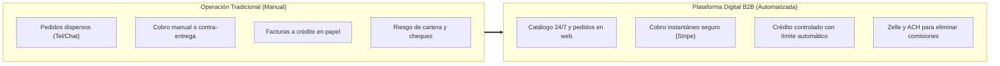

# Resumen Ejecutivo: Evolución Comercial y Pasarela Stripe
## Jhoanes Bakery & Wholesale — De la Operación Tradicional a la Venta Digital B2B

> **Para el Cliente**: Guía rápida y visual que resume cómo la integración con Stripe transformó la operación diaria de cobros en un sistema seguro, automático y sin pérdidas.

---

## 1. El Cambio: Antes vs. Ahora

| Aspecto | Antes (Operación Tradicional) | Ahora (Con Stripe & B2B) |
| :--- | :--- | :--- |
| **Cobro de Contado** | Efectivo en ruta, cheques o transferencias sin conciliar. | Cobro automático con tarjeta o Zelle validado antes de hornear. |
| **Clientes a Crédito** | Cuadernos o confianza manual. | Línea de crédito digital (`Net-15`); el sistema bloquea compras si excede su límite. |
| **Tiempo de Compra** | El cliente tipea su tarjeta cada vez o espera factura. | **Compra en 1-Clic**: su tarjeta queda guardada en la bóveda de Stripe. |
| **Pedidos Grandes (\$1k+)** | Las comisiones de tarjeta quitaban hasta \$90 por pedido. | **ACH Direct Debit (Tope \$5)** o **Zelle (\$0)** preservan el margen completo. |
| **Reclamos y Mermas** | Ajustes manuales en la siguiente nota de entrega. | **Reembolso en 1 Clic**: se devuelve saldo a la tarjeta desde el panel de administración. |
| **Ventas Recurrentes** | Recordar llamar al cliente cada lunes o miércoles. | **Pedidos Semanales Fijos**: el sistema genera y cobra la orden automáticamente. |

---

## 2. Estrategias Comerciales Ya Implementadas

1. **Blindaje de Margen Mayorista**:
   * Cargo de 3.5% en tarjeta compensado con **Bonificación del 100% en Zelle**. El cliente ahorra y Jhoanes no pierde.
2. **Compra Rápida en 1-Clic**:
   * Tarjetas guardadas de forma tokenizada (cumple con normas de seguridad bancaria PCI-DSS sin almacenar números en nuestros servidores).
3. **Cobro Bancario ACH para Cuentas Grandes**:
   * Tarifa plana de máximo **\$5.00 USD**, ideal para pedidos de \$1,500 a \$3,000.
4. **Reembolsos Parciales Administrativos**:
   * En `/admin/orders`, el administrador puede reembolsar exactamente el valor de un producto dañado sin entrar a la web de Stripe.
5. **Suscripciones Mayoristas Semanales**:
   * Pedidos automáticos programados para clientes con consumo diario asegurado.

---

## 3. Propuestas de Expansión Estratégica (Roadmap para Decisión del Cliente)

Para continuar profesionalizando la operación comercial sin aumentar la carga de trabajo del equipo, se proponen las siguientes 4 capacidades modulares listas para activar cuando el negocio lo requiera:

| Propuesta | ¿Qué problema resuelve? | ¿Cómo funciona? | Beneficio Directo para Jhoanes |
| :--- | :--- | :--- | :--- |
| **1. Auto-Débito Net-15/30** | Cobranzas manuales y retrasos en clientes a crédito. | Si el cliente no paga su factura antes del día 15, se debita automáticamente de su tarjeta o ACH guardado. | **Cero morosidad** y flujo de caja puntual garantizado. |
| **2. Pre-Autorización (Hold)** | Ajustes por peso variable de masa o mermas de último minuto. | Se congelan los fondos al ordenar y solo se captura el monto exacto una vez pesado y empacado el pedido. | Elimina micro-reembolsos y cobros extra posteriores. |
| **3. Conexión QuickBooks / Xero** | Doble digitación manual de facturas para contabilidad e impuestos. | Cada venta y pago en la web se refleja en tiempo real en el software contable de la panadería. | **Ahorro de horas administrativas** y cierre mensual automático. |
| **4. Anticipos para Catering / Eventos** | Riesgo de cancelación en pedidos gigantes con materias primas costosas. | Cobro automático de un anticipo (30% - 50%) al reservar y el resto 24 horas antes del despacho. | **Blindaje total contra cancelaciones** de lotes grandes. |
