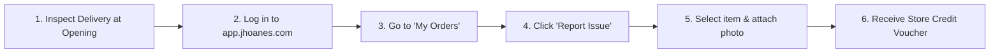

# Quick Guide for B2B Clients: Reporting Delivery Issues & Using Store Credit
## Jhoanes Bakery B2B Platform (`app.jhoanes.com`)

* **Document Code:** `GUIDE-CLI-002-EN`
* **Version:** `2.0.0`
* **Target Audience:** Coffee Shop Owners, Café Managers, Kitchen Directors, and Receiving Staff.

---

## 1. How Store Credit Works

At Jhoanes Bakery, our artisanal croissants and pastries are freshly baked overnight and delivered early in the morning so your café opens with warm, fresh goods.

If you ever experience a shortage, transit damage, or quality discrepancy upon opening your delivery boxes, **there is no need to wait days for credit card disputes or bank refund delays**:

We credit the full value directly to your account as **Store Credit**, ready to be automatically deducted on your next online order.

> [!IMPORTANT]
> **Golden Rule: Report Before 10:00 AM**
> Because our artisanal baked goods are fresh, preservative-free, and delivered daily, all delivery discrepancies must be reported through your portal **before 10:00 AM** on the morning of delivery.

---

## 2. Step-by-Step: How to Report an Issue from your Phone or Computer

### Step 1: Log in to Your Account
Open [app.jhoanes.com](https://app.jhoanes.com) on your smartphone or desktop computer using your registered email and password.

### Step 2: Locate Today's Delivery
Click on **"My Orders"** in the top navigation bar or under your account profile. Select the order received this morning.

### Step 3: Click "Report Delivery Issue / Incident"
Click the highlighted report button (shield/alert icon). A simple form will appear:
1. **Select the Issue Category**:
   - 📦 **Bakery Shortage**: Product listed on the invoice was not in the crate.
   - 🥐 **Crushed / Transit Damage**: Pastries flattened or crushed during vehicle transport.
   - 🔥 **Bake / Quality Defect**: Product over-baked, under-baked, or out of standard.
   - 🔄 **Wrong Item Received**: Different variety delivered from what was ordered.
2. **Specify the Quantity Affected**: (e.g., 4 Almond Croissants).
3. **Attach Photo Evidence**:
   - Snap a clear photo of the damaged items in their crate/box, or a photo of the signed physical delivery ticket with the shortage note.
   - You can upload photos directly from your smartphone camera.
4. **Add a Brief Note**: (e.g., *"Bottom box arrived compressed"*).
5. Click **Submit Report**.

---

## 3. What Happens Next?

1. **Instant Notification**: Our dispatch and support team receives your ticket in real time.
2. **Digital Gift Card Delivery**:
   - You will immediately receive a confirmation email:  
     `🎁 Store Credit Issued - Jhoanes Bakery (Voucher: SC-2026-XXXX)`.
   - The email includes your **Digital Store Credit Voucher** displaying the exact dollar balance and voucher ID.
3. **Instant Account Balance Update**:
   - Your Store Credit is active right away on your profile.

---

## 4. How to Redeem Your Store Credit on Your Next Order

Redeeming your credit is 100% automated—no promo codes to type or remember:

1. Add your desired products to the cart and proceed to **Checkout**.
2. At the payment step, the platform automatically detects your active balance:
   > 💳 **Available Store Credit:** `$45.00`  
   > `[✓] Automatically apply to this order (-$45.00)`
3. Your order subtotal is deducted immediately.
4. If your order exceeds the credit amount, simply pay the remaining balance using your preferred method (Credit Card, Zelle, or Check). If the credit covers the full order, your order is confirmed with 1 click!

---

## 5. Summary of Best Practices

| Situation | Recommended Action | What to Avoid |
| :--- | :--- | :--- |
| **Overnight Delivery (Key/Lockbox)** | Inspect delivery boxes as soon as morning staff opens the shop. | Waiting until afternoon or the next day to inspect goods. |
| **Missing Product** | Take a quick photo of the driver's delivery comanda with the shortage marked. | Not recording the missing item on the physical ticket. |
| **Damaged Product** | Take a clear photo of the affected pastries inside the box before disposal. | Discarding damaged items without photographic evidence. |
| **Reporting Deadline** | Submit your report before **10:00 AM**. | Submitting after 10:00 AM (the system closes reports after the morning deadline). |
