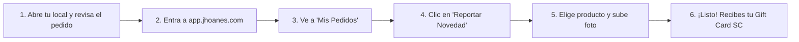

# Guía Rápida para Clientes: Reporte de Incidencias y Uso de Saldo a Favor (Store Credit)
## Jhoanes Bakery B2B (`app.jhoanes.com`)

* **Código de Documento:** `GUIA-CLI-002`
* **Versión:** `2.0.0`
* **Para:** Propietarios de Cafeterías, Gerentes de Tienda y Encargados de Recepción.

---

## 1. ¿Cómo funciona el Saldo a Favor (Store Credit)?

En Jhoanes Bakery horneamos diariamente de madrugada para que recibas tus croissants y panes artesanales frescos antes de abrir tu local. 

Si al momento de abrir tus cajas notas algún faltante, producto aplastado durante el transporte o cualquier problema de calidad, **no tienes que esperar días por reembolsos bancarios ni papeleos**: 

Te acreditamos inmediatamente el valor correspondiente como **Saldo a Favor (Store Credit)** directo en tu cuenta virtual, listo para descontarse automáticamente en tu siguiente pedido.

> [!IMPORTANT]
> **Regla de Oro: Ventana de Reporte hasta las 10:00 AM**
> Debido a que elaboramos panadería artesanal fresca sin conservantes, todas las novedades de la entrega del día deben reportarse a través de la plataforma **antes de las 10:00 AM** de esa misma mañana.

---

## 2. Paso a Paso: Cómo Reportar una Incidencia desde tu Celular o Computadora

### Paso 1: Ingresa a tu Cuenta
Entra en [app.jhoanes.com](https://app.jhoanes.com) desde tu celular o computadora con tu correo y contraseña habitual.

### Paso 2: Ubica tu Pedido
Ve a la sección **"Mis Pedidos"** en el menú superior o en tu perfil. Haz clic en el pedido que acabas de recibir esta mañana.

### Paso 3: Haz Clic en "Reportar Novedad / Incidencia"
Verás un botón destacado con el ícono de escudo/atención. Al hacer clic se abrirá una ventana sencilla:
1. **Selecciona el Tipo de Problema**:
   - 📦 **Faltante de Cocina**: El producto no venía en la caja o comanda.
   - 🥐 **Producto Aplastado / Dañado**: Daño físico sufrido durante el traslado en el furgón.
   - 🔥 **Defecto de Calidad**: Producto sobre-dorado, crudo o fuera del estándar visual.
   - 🔄 **Producto Equivocado**: Recibiste una variedad distinta a la ordenada.
2. **Indica la Cantidad afectada**: (ej. 4 Croissants de Almendras).
3. **Adjunta la Foto de Evidencia**:
   - Toma una foto clara del producto dañado dentro de su caja o de la comanda física donde marcaste el faltante.
   - La foto se sube directamente desde la cámara de tu smartphone.
4. **Agrega un comentario breve**: (ej. *"Caja inferior llegó aplastada"*).
5. Haz clic en **Enviar Reporte**.

---

## 3. ¿Qué sucede después de enviar el reporte?

1. **Confirmación Inmediata**: Nuestro equipo de despacho y administración recibe una notificación en tiempo real.
2. **Recepción de tu Tarjeta de Saldo a Favor**:
   - Recibirás un correo electrónico automático titulado:  
     `🎁 Saldo a Favor Acreditado - Jhoanes Bakery (Voucher: SC-2026-XXXX)`.
   - El correo incluye tu **Tarjeta Digital de Saldo** con el monto exacto en dólares y tu código único de voucher.
3. **Balance Actualizado al Instante**:
   - Tu saldo queda disponible de inmediato en tu perfil para ser usado.

---

## 4. Cómo redimir tu Store Credit en tu siguiente compra

No tienes que recordar códigos difíciles ni hacer transferencias manuales:

1. Ingresa a la tienda, arma tu pedido habitual en el catálogo y dirígete al **Carrito / Checkout**.
2. Al llegar a la pantalla de pago, el sistema detectará automáticamente tu balance:
   > 💳 **Saldo a Favor Disponible:** `$45.00`  
   > `[✓] Aplicar automáticamente a esta orden (-$45.00)`
3. El total de tu pedido se reducirá inmediatamente por ese importe.
4. Si el pedido es mayor a tu saldo, solo pagarás la diferencia restante con tu método de pago preferido (Tarjeta, Zelle o Cheque). Si tu saldo cubre todo el pedido, ¡la orden queda pagada en un clic!

---

## 5. Resumen de Buenas Prácticas

| Situación | Qué Hacer | Qué Evitar |
| :--- | :--- | :--- |
| **Entrega Nocturna (con llave / código)** | Revisar las cajas apenas el personal ingrese al local en la mañana. | Esperar a la tarde o al día siguiente para revisar la mercancía. |
| **Faltante de Producto** | Tomar foto a la comanda física entregada por el chofer. | No dejar registro en la comanda ni en el portal. |
| **Producto Dañado** | Tomar foto nítida de los panes afectados en la caja. | Desechar el producto sin haber tomado la fotografía de evidencia. |
| **Ventana Horaria** | Subir el reporte antes de las **10:00 AM**. | Reportar después de las 10:00 AM (el portal bloquea reportes extemporáneos). |
