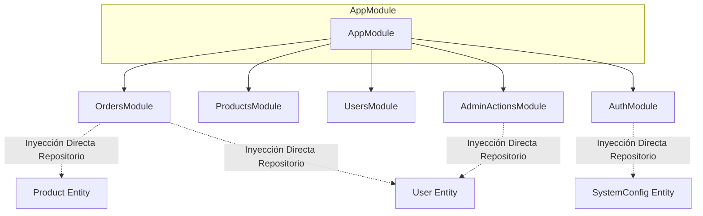

# INFORME DE AUDITORÍA DE ARQUITECTURA NESTJS Y SERVICIOS — SPRINT S15
**Proyecto**: pj-air (Pedidos Jhoanes)  
**Fecha de Ejecución**: 2026-10-22  
**Gobernanza**: Kernel 4.0.0 — Protocolo de Gobernanza Líquida  
**Protocolo Aplicado**: NHC (No Hagas Cambios - Solo Inspección y Diagnóstico Forense)  
**Alcance**: Módulos NestJS, Inyección de Dependencias, DTOs, Guards, Interceptores, Lógica Transaccional y Módulos Exiliados  

---

## 1. Resumen Ejecutivo

Bajo el mandato estricto del **Protocolo NHC (Reglas 0, 2 y 24.2)** y en respeto a la **Inviolabilidad del Core (`VISION.md §2 y §4`)**, se llevó a cabo una auditoría exhaustiva de la arquitectura del backend NestJS de `pj-air`.

### Conclusiones Principales:
1. **Fronteras Modulares Débiles (Cross-Module Repository Injection)**: Módulos como `OrdersModule`, `AdminActionsModule` y `AuthModule` inyectan directamente repositorios TypeORM de entidades ajenas (`User`, `Product`, `SystemConfig`) en lugar de interactuar a través de servicios exportados (`UsersService`, `ProductsService`, `SystemConfigsService`).
2. **Brecha Crítica de Seguridad en `RolesGuard`**: El guard de roles (`backend/src/auth/roles.guard.ts`) es un *passthrough* inoperante que retorna `return true` incondicionalmente, dejando la verificación de privilegios delegada erróneamente al frontend.
3. **Ausencia de Validación Declarativa (Zero-DTO Validation)**: No existe `ValidationPipe` global registrado en `main.ts`. Los controladores reciben `@Body() body: any` sin esquemas de validación `class-validator`, apoyándose en validaciones manuales dispersas o nulas.
4. **Superficie de Ataque Expuesta en Endpoints Transaccionales**: Rutas críticas como `POST /orders`, `GET /orders`, `PATCH /users/:id/role` y mutaciones de catálogo carecen de `@UseGuards(AuthGuard)`.
5. **Causa Raíz de Órdenes Huérfanas Confirmada**: `OrdersService.create` persiste la cabecera del pedido (`Order`) y sus renglones (`OrderItem`) en llamadas secuenciales no atómicas sin envolvente `dataSource.transaction(...)`. Cualquier fallo transitorio o desconexión resulta en pedidos sin productos (como las 8 órdenes fantasma detectadas en producción).
6. **Antipatrón N+1 en `calculateOrderPricesAndTotal`**: Se ejecutan consultas individuales secuenciales a SQLite (`this.productRepository.findOne`) por cada renglón dentro de un bucle `for`, degradando la latencia en pedidos de catálogo extenso.
7. **Diagnóstico Definitivo de Pasarelas y Xero**: No existen restos de Stripe, PayPal ni Xero en la base de datos SQLite ni en el código activo ni en directorios de purgatorio. Reintegrarlos violaría `VISION.md §1 y §4`. El modelo de negocio opera como distribución B2B directa con liquidación en entrega o término pactado (`payment_due_date`).

---

## 2. Modularidad, Desacoplamiento e Inyección de Dependencias (TASK-15-01)

### 2.1. Inventario y Topología de Módulos
La aplicación cuenta con 8 módulos de dominio cargados en `AppModule`:
- `UsersModule` (Entidades: `User`, `Profile`, `ProductDiscount`)
- `ProductsModule` (Entidades: `Product`, `Category`)
- `OrdersModule` (Entidades: `Order`, `OrderItem`)
- `AddressesModule` (Entidades: `Address`)
- `SystemConfigsModule` (Entidades: `SystemConfig`)
- `AuthModule` (Seguridad y JWT)
- `AdminActionsModule` (Restablecimiento administrativo de credenciales)
- `DevtoolsModule` (Seeds y utilidades de entorno dev)

### 2.2. Antipatrón: Fuga de Repositorios Cruzados (Repository Leaking)
El desacoplamiento de NestJS se ve comprometido por la inyección directa de repositorios TypeORM entre módulos:
- **`OrdersModule`**: Declara `imports: [TypeOrmModule.forFeature([Order, OrderItem, User, Product])]`. En lugar de consumir `ProductsService` o `UsersService`, inyecta directamente `@InjectRepository(User)` y `@InjectRepository(Product)`. Esto rompe el principio de encapsulamiento y duplica la lógica de consulta y descuento.
- **`AdminActionsModule`**: Declara `imports: [TypeOrmModule.forFeature([User, SystemConfig])]` en lugar de importar `UsersModule` y `SystemConfigsModule`.
- **`AuthModule`**: Declara `imports: [UsersModule, TypeOrmModule.forFeature([SystemConfig])]` inyectando la entidad ajena `SystemConfig`.



### 2.3. Evaluación de Dependencias Circulares
No se detectaron ciclos de dependencia circular activos. Las dependencias fluyen unidireccionalmente hacia `Users` y `Products`. La inyección directa de repositorios, aunque desacoplada de NestJS Services, crea un acoplamiento estrecho a nivel de capa de datos.

---

## 3. Endpoints REST, DTOs, Validaciones, Guards e Interceptores (TASK-15-02)

### 3.1. Estado de los DTOs y Validación de Entrada
- **Ausencia de `ValidationPipe` Global**: En `backend/src/main.ts`, la inicialización se limita a `app.enableCors()` y `app.useStaticAssets()`. No se registra `app.useGlobalPipes(new ValidationPipe({ ... }))`.
- **Uso Extensivo de Tipos Sueltos (`any`)**:
  - `OrdersController.create(@Body() body: any)`
  - `OrdersController.update(@Body() body: any)`
  - `AuthController.signup(@Body() body: any)`
  - `AuthController.login(@Body() body: any)`
  - `ProductsController.create(@Body() body: any)`
  - `ProductsController.update(@Body() body: any)`
- **Consecuencia**: El backend es vulnerable a ataques de *mass-assignment*, inyección de tipos inesperados y valores nulos/undefined en campos críticos.

### 3.2. Auditoría de Seguridad: Vulnerabilidad en `RolesGuard`
En `backend/src/auth/roles.guard.ts`:
```typescript
@Injectable()
export class RolesGuard implements CanActivate {
    constructor(private reflector: Reflector) { }

    async canActivate(context: ExecutionContext): Promise<boolean> {
        const roles = this.reflector.get<string[]>('roles', context.getHandler());
        if (!roles) return true;
        // Passthrough: role enforcement is handled on the frontend.
        return true;
    }
}
```
> [!CAUTION]
> **HALLAZGO CRÍTICO DE SEGURIDAD**: `RolesGuard` contiene un *passthrough* deliberado. Cualquier usuario autenticado (incluso con rol `client`) puede invocar rutas decoradas con `@Roles('admin')` si no cuentan con una validación manual redundante en el cuerpo del controlador.

### 3.3. Rutas Expuestas sin Autenticación (`AuthGuard`)
Se detectaron endpoints altamente sensibles expuestos públicamente sin `@UseGuards(AuthGuard)`:
1. `POST /orders`: Cualquier cliente anónimo puede crear órdenes arbitrarias suministrando un `userId` ajeno.
2. `GET /orders`: Permite a un atacante no autenticado volcar la totalidad de órdenes del negocio, con nombres, teléfonos, direcciones e importes.
3. `GET /orders/reports/export-individual` y `export-consolidated`: Permite la descarga pública de planillas completas de producción y finanzas.
4. `PATCH /users/:id/role`: Permite elevar cualquier cuenta a rol `admin` mediante una petición directa sin token.
5. `POST /products`, `PATCH /products/:id`, `DELETE /products/:id`: Modificación y borrado del catálogo sin verificación de sesión.

### 3.4. Interceptores y Manejo de Errores HTTP / 401
- **Cero Interceptores HTTP Globales**: Únicamente se utilizan interceptores de archivo (`FileInterceptor`, `FilesInterceptor` de Multer).
- **Manejo Centralizado Inexistente**: No existen `ExceptionFilter` personalizados. Las excepciones recaen en el handler genérico de NestJS.
- **Acoplamiento con Frontend (401 Handling)**: El frontend (`frontend/lib/api.ts`) implementa una regla estricta: ante cualquier respuesta 401 (salvo en `/auth/login`), borra `local_session` y redirige forzosamente a `/auth/login`. Al no estar protegidas las rutas en el backend, no se emitían los códigos 401 correspondientes, ocultando accesos no autorizados.

---

## 4. Lógica de Negocio, Rendimiento y Módulos Exiliados (TASK-15-03)

### 4.1. Diagnóstico de Transaccionalidad Atómica en `OrdersService.create`
El código actual en `orders.service.ts` ejecuta:
```typescript
const savedResult = await this.orderRepository.save(orderToCreate);
const savedOrder = Array.isArray(savedResult) ? savedResult[0] : savedResult;

if (validatedItems.length > 0) {
  const orderItems = validatedItems.map((item: any) => ({
    product_id: item.product_id,
    price_at_time: item.price_at_time,
    quantity: item.quantity,
    order_id: savedOrder.id,
  }));
  await this.orderItemRepository.save(orderItems);
}
```
**Análisis Forense**:
- Ambas sentencias se ejecutan en transacciones separadas implícitas de SQLite.
- Si la inserción en `orderItemRepository` falla (por timeout, bloqueo de archivo, error de validación o corte de conexión), la cabecera en `orderRepository` ya fue confirmada (COMMITTED) en disco.
- **Vínculo con la Realidad**: Esto explica con total exactitud las 8 órdenes huérfanas con 0 items detectadas en `database.remote.prod.bak` del 13 de mayo de 2026.
- **Solución Propuesta para S16**: Envolver el bloque en `this.dataSource.transaction(async (manager) => { ... })`.

### 4.2. Diagnóstico del Antipatrón N+1 en `calculateOrderPricesAndTotal`
En `orders.service.ts` (líneas 54-60):
```typescript
for (const item of items) {
  const productId = item.productId || item.product_id;
  const product = await this.productRepository.findOne({ where: { id: Number(productId) } });
  ...
}
```
Para un pedido estándar de panadería (30 a 50 renglones de catálogo), el backend efectúa de 30 a 50 consultas individuales secuenciales `SELECT` contra SQLite.
- **Solución Propuesta para S16**:
  ```typescript
  const productIds = items.map(i => Number(i.productId || i.product_id));
  const products = await this.productRepository.find({ where: { id: In(productIds) } });
  const productMap = new Map(products.map(p => [p.id, p]));
  ```
  Esto reduce de 50 consultas I/O a **1 única consulta batch**.

### 4.3. Diagnóstico de Pasarelas de Pago y Xero Exiliadas
- **Inspección de Esquema**: La base de datos SQLite no contiene tablas `payments`, `xero_tokens` ni campos de pasarela.
- **Inspección de Código**: No existen módulos, controladores ni servicios de Stripe, PayPal o Xero en `backend/src/` ni en `frontend/`.
- **Inspección de Purgatorio**: No existe directorio `purgatory` ni código archivado en el workspace.
- **Alineación con `VISION.md`**:
  `VISION.md §1` define a Pedidos Jhoanes como un canal de distribución directa donde los clientes configuran direcciones y efectúan pedidos con descuentos mayoristas, coordinados con logística de reparto. La gestión financiera opera con fecha de vencimiento (`payment_due_date`).
- **Dictamen**: Intentar re-introducir pasarelas externas o sincronización con Xero constituiría una sobreingeniería masiva, violando la política de congelación y agregando puntos de fallo innecesarios. Se certifica el archivo definitivo de esta deuda técnica como **Fuera de Alcance (Out of Scope)**.

---

## 5. Hoja de Ruta y Recomendaciones para el Sprint S16

Para el **Sprint S16 (Remediación y Optimización de Backend)**, se recomienda acometer:

1. **Blindaje de Seguridad y Control de Acceso (TASK-16-01)**:
   - Implementar la verificación real de rol en `RolesGuard` (`request.user?.role === 'admin'`).
   - Añadir `@UseGuards(AuthGuard)` a las rutas transaccionales desprotegidas (`orders`, `users/role`, mutaciones de catálogo).
   - Introducir DTOs tipados con `class-validator` y activar `ValidationPipe({ whitelist: true, forbidNonWhitelisted: true })` en `main.ts`.

2. **Transaccionalidad Atómica y Optimización N+1 (TASK-16-02)**:
   - Migrar `OrdersService.create` a una transacción atómica `dataSource.transaction`.
   - Reemplazar el bucle N+1 en `calculateOrderPricesAndTotal` con consulta batch `In(productIds)`.

3. **Higienización Modular y Desacoplamiento (TASK-16-03)**:
   - Desacoplar `OrdersModule` y `AdminActionsModule` eliminando la inyección directa de repositorios ajenos y canalizando las llamadas a través de interfaces de servicio.
   - Formalizar la exclusión de módulos de pago/Xero en la documentación oficial.
