# INFORME DE AUDITORÍA DE FRONTEND NEXT.JS Y EXPERIENCIA UI — SPRINT S17
**Proyecto**: pj-air (Pedidos Jhoanes)  
**Fecha de Ejecución**: 2026-10-22  
**Gobernanza**: Kernel 4.0.0 — Protocolo de Gobernanza Líquida  
**Protocolo Aplicado**: NHC (No Hagas Cambios - Solo Inspección Profunda y Diagnóstico Forense)  
**Alcance**: Next.js 16 App Router, Componentes Server vs Client, Estado Global (Contexts), Seguridad y Sesión, Flujos Transaccionales (Catálogo -> Checkout -> Admin), Rendimiento y Peso de Bundles  

---

## 1. Resumen Ejecutivo

En cumplimiento estricto del **Protocolo NHC (Reglas 0, 2 y 24.2)** y el alcance asignado para la Fase 2, se ejecutó una inspección exhaustiva de la arquitectura de frontend en Next.js (`frontend/`).

### Hallazgos Críticos Principales:
1. **Monocultura de Client Components (`'use client'`)**: El 100% de las páginas en `frontend/app/` (29 rutas completas) declaran `'use client'`. Next.js App Router está operando de facto como un contenedor SPA (Single Page Application), desperdiciando las capacidades nativas de React Server Components (RSC), Suspense streaming y Server Actions.
2. **Discrepancia Crítica de Cálculo de Descuentos (Bug Financiero UI vs Backend)**:
   - En Frontend (`CartContext.tsx` y `checkout/page.tsx`), el descuento general del cliente se aplica **multiplicativamente sobre el subtotal que ya contiene descuentos específicos de producto**, produciendo un doble descuento acumulado erróneo.
   - En Backend (`OrdersService.calculateOrderPricesAndTotal`), el descuento general es excluyente por renglón (`else if`), aplicándose únicamente a productos que carecen de descuento individual.
   - **Impacto**: El checkout muestra al cliente un total inferior al que el backend realmente calcula, persiste y cobra en la orden.
3. **Ausencia Total de `middleware.ts` (Fugas de Seguridad y FOUC)**: La protección de rutas administrativas (`/admin/*`), operativas (`/produccion/*`, `/delivery/*`) y privadas (`/orders`, `/profile`) depende exclusivamente de `useEffect` en el cliente. Next.js envía los bundles completos al navegador no autenticado antes de que un hook ejecute `router.push('/auth/login')`, provocando destellos de contenido desprotegido (FOUC) y posibles bucles de redirección.
4. **Manejo de Sesión en `localStorage` Vulnerable y Frágil**: `api.ts` lee el JWT desde `localStorage.getItem('local_session')`. Ante un error HTTP 401, ejecuta `window.location.href = '/auth/login'` sin coordinación de peticiones concurrentes, causando redirecciones abruptas si múltiples endpoints fallan simultáneamente. Al no usar cookies `httpOnly`, las peticiones no pueden ser autenticadas en Server Components.
5. **Componentes Monolíticos Sobredimensionados (Gigantismo UI)**:
   - `admin/reports/page.tsx`: 1,076 líneas.
   - `checkout/page.tsx`: 924 líneas.
   - `app/page.tsx` (Catálogo): 783 líneas.
   - `admin/orders/page.tsx`: 721 líneas.
   - `admin/clients/page.tsx`: 707 líneas.
   La falta de subcomponentes y memoización provoca re-renderizados masivos en cada pulsación de tecla o cambio de cantidad.
6. **Código Huérfano y Dependencias Exiliadas en Bundle**:
   - `@supabase/supabase-js` permanece instalado en `package.json` y se importa en `AuthContext` (solo para tipos) y `DevTools.tsx`, inyectando ~150KB de código muerto de un backend SaaS ya abandonado.
   - Componentes duplicados y huérfanos: `frontend/components/catalog/` (`ProductCard.tsx`, `ProductCardCompact.tsx`, `CatalogHeader.tsx`, `CategoryFilters.tsx`) existen pero están abandonados; las páginas de catálogo reimplementan `ProductCard` de forma duplicada e inlined.
   - Ruta experimental olvidada: `frontend/app/admin/productos2/page.tsx` (575 líneas de código clonado sin enlaces en la navegación).

---

## 2. Auditoría de Arquitectura Next.js App Router (TASK-17-01)

### 2.1. Topología de Rutas y Mapeo
La aplicación cuenta con las siguientes ramas bajo `frontend/app/`:

```mermaid
graph TD
    Root["/ (Landing / Catálogo 783L)"]
    Auth["/auth"]
    Catalog["/catalog"]
    Checkout["/checkout (924L)"]
    Orders["/orders"]
    Admin["/admin"]
    Delivery["/delivery"]
    Produccion["/produccion"]
    Profile["/profile"]
    Map["/map (Diagrama UX)"]

    Auth --> Login["/auth/login"]
    Auth --> Register["/auth/register"]
    Auth --> Forgot["/auth/forgot-password"]

    Catalog --> CatId["/catalog/[id]"]
    Catalog --> CatFilter["/catalog/category/[category]"]

    Orders --> OrderDetail["/orders/[id]"]

    Admin --> AdminDash["/admin (Overview)"]
    Admin --> AdminReports["/admin/reports (1076L)"]
    Admin --> AdminOrders["/admin/orders (721L)"]
    Admin --> AdminClients["/admin/clients (707L)"]
    Admin --> AdminProds["/admin/products"]
    Admin --> AdminProds2["/admin/productos2 (HUÉRFANO)"]
    Admin --> AdminCats["/admin/categories"]
    Admin --> AdminUsers["/admin/users"]
    Admin --> AdminRoutes["/admin/routes"]
    Admin --> AdminSettings["/admin/settings"]
    Admin --> AdminZones["/admin/zones"]
    Admin --> AdminNotifs["/admin/notifications"]

    Profile --> Addresses["/profile/addresses"]
    Addresses --> NewAddress["/profile/addresses/new"]
```


### 2.2. Paradoja Server vs Client Components
- Todas las rutas clave están marcadas con `'use client'`.
- **Causa Raíz**: Debido a que la autenticación reside en `localStorage`, ningún Server Component puede acceder a las credenciales del usuario para pre-renderizar datos en el servidor.
- **Consecuencia**: El motor de SSR de Next.js se reduce a servir esqueletos vacíos que luego realizan múltiples llamadas REST mediante `fetch` en el navegador, aumentando el Time-To-Interactive (TTI) y First Contentful Paint (FCP).

### 2.3. Evaluación de Contexts y Estado Global
1. **`AuthContext.tsx`**:
   - Carga la sesión desde `localStorage.getItem('local_session')`.
   - Realiza una segunda llamada REST en cascada `api.get('/users/${userId}')` para obtener el perfil completo y rol.
   - No expone estados de expiración o refresh token.
2. **`CartContext.tsx`**:
   - Aísla los carritos por clave de almacenamiento (`jhoanes-cart-${userId}` o `jhoanes-cart-guest`).
   - El proveedor recrea las funciones de cálculo (`getRawSubtotal`, `getDiscountedSubtotal`, `getFinalTotal`) en cada render sin `useCallback` ni `useMemo`.
   - Como `CartProvider` envuelve a toda la aplicación en `layout.tsx`, cualquier cambio en el carrito desencadena una ola de re-renderizados en toda la jerarquía activa.
3. **`LanguageContext.tsx`**:
   - Administra traducciones estáticas (`es.ts`, `en.ts`). Funciona adecuadamente sin impacto mayor en rendimiento.

### 2.4. Diagnóstico de 401 Loops y Manejo de Errores
- En `frontend/lib/api.ts`, líneas 15-24:
  ```typescript
  if (response.status === 401 && !response.url.includes('/auth/login')) {
    if (typeof window !== 'undefined') {
      localStorage.removeItem('local_session');
      const currentPath = window.location.pathname;
      if (currentPath !== '/auth/login' && currentPath !== '/auth/register') {
        window.location.href = '/auth/login';
      }
    }
    throw new Error('Sesión expirada. Por favor, inicia sesión de nuevo.');
  }
  ```
- **Riesgo**: El uso de `window.location.href` fuerza una recarga destructiva completa del documento en lugar de una transición SPA vía `router.replace('/auth/login')`. Si una vista carga tres recursos simultáneos (`/users`, `/products`, `/orders`) y el token expiró, se disparan tres excepciones y tres intentos de redirección competitivos.

---

## 3. Auditoría de Flujos Transaccionales de Usuario (TASK-17-02)

### 3.1. Flujo de Compra: Catálogo -> Carrito -> Checkout -> Confirmación
1. **Catálogo (`app/page.tsx`)**:
   - Carga productos vía REST al montar.
   - Si el usuario no está logueado, muestra un modal bloqueante `LoginModal` en lugar de una redirección limpia.
   - No implementa virtualización de lista: los 50+ productos con imágenes en alta resolución se pintan simultáneamente en el DOM.
2. **Carrito (`context/CartContext.tsx`)**:
   - Permite agregar y modificar cantidades con validación de cantidad mínima por categoría (`category_min_qty`).
3. **Checkout (`app/checkout/page.tsx` - 924 líneas)**:
   - Integra selector de fecha de entrega, fecha de pago B2B y 3 modalidades de entrega: recogida en tienda (`pickup`), dirección guardada (`saved`) o nueva dirección con geocodificación interactiva en Google Maps (`other`).
   - La pantalla es excesivamente pesada porque incluye el formulario inline de dirección, el visor de Google Maps, el resumen de ítems y la validación de pedido mínimo en un solo archivo.
4. **Discrepancia Matemática Crítica en Descuentos**:
   - **Frontend**:
     ```typescript
     // Paso 1: aplica descuento de producto
     itemPrice = pd.special_price || (price * (1 - pd.discount_percentage / 100));
     // Paso 2: aplica descuento general SOBRE TODO EL SUBTOTAL
     subtotal = rawSubtotal * (1 - general_discount / 100);
     ```
   - **Backend (`OrdersService.calculateOrderPricesAndTotal`)**:
     ```typescript
     if (productDiscount) {
       finalPrice = special_price || (price * (1 - discount_percentage / 100));
     } else if (user.general_discount > 0) {
       finalPrice = price * (1 - user.general_discount / 100);
     }
     ```
   - **Efecto**: Si un cliente mayorista tiene 10% de descuento general y un producto de $50 tiene precio especial de $45:
     - El frontend le cobra $45 * 0.90 = **$40.50**.
     - El backend le factura **$45.00**.
     - **Discrepancia de $4.50 por unidad**.

### 3.2. Divergencia en Estados de Orden
Existe una incompatibilidad semántica grave entre los estados reportados en la base de datos y los manejados por las interfaces:

| Módulo / Capa | Nomenclatura de Estados |
|---|---|
| **Backend Core** | `pending`, `confirmed`, `shipped`, `delivered`, `cancelled` |
| **Admin Orders UI** | `Pedido`, `En Producción`, `Finalizado`, `En camino`, `En Entrega`, `Entregado`, `Cancelado` |
| **Customer Tracking UI**| `Pedido Enviado`, `En Producción`, `En Delivery`, `Entregado` |

La ausencia de un enum canónico unificado provoca que órdenes con estado backend `shipped` o `confirmed` no coincidan exactamente con los pasos visuales del cliente sin transformaciones arbitrarias.

### 3.3. Pantallas Administrativas
- **`admin/reports` (1,076 líneas)**: Implementa cálculos matemáticos masivos para convertir fechas UTC a zona horaria de producción de New York (`nyDate.getHours() >= 13 ? +1 día : 0`), agrupando productos por categoría y cliente en una tabla matricial. Esta lógica de transformación de reportes debería residir en el backend (`ExcelService` o un endpoint analítico JSON) y no recalcularse en el hilo principal de React en el navegador.
- **`admin/clients` (707 líneas)**: Mantiene 18 estados `useState` locales, mezclando búsqueda de usuarios, edición de tarifas de entrega, asignación de descuentos y edición modal de direcciones.

---

## 4. Rendimiento, Bundles y Sobreingeniería Reactiva (TASK-17-03)

### 4.1. Análisis de Dependencias y Peso de Bundles
Inspección de `frontend/package.json`:
- **`@supabase/supabase-js` (2.97.0)**: **CÓDIGO MUERTO**. Pesa más de 150 KB minificado. No se utiliza para base de datos ni autenticación (la aplicación usa NestJS + SQLite). Debe ser purgado formalmente.
- **`@react-google-maps/api` (2.20.8)**: Pesa ~90 KB. Se importa de forma estática en `checkout/page.tsx` y `profile/addresses/new/page.tsx`. Debe cargarse dinámicamente mediante `next/dynamic` únicamente cuando el usuario seleccione entrega a nueva dirección.
- **`lucide-react` (0.575.0)**: Más de 20 iconos importados por página. Requiere verificación de tree-shaking para evitar la inclusión innecesaria del catálogo completo de iconos.

### 4.2. Sobreingeniería y Estado Huérfano
1. **El Hook Olvidado (`useApiCall.ts`)**: Se creó una abstracción limpia `useApiCall` para estandarizar estados de carga y error, pero **ningún componente del sistema lo utiliza**. Todas las vistas reinventan el patrón con `useState(true)` y `try/catch`.
2. **Duplicación de Componentes de Catálogo**:
   - `frontend/components/catalog/ProductCard.tsx` (149L) -> No se usa.
   - `frontend/components/catalog/ProductCardCompact.tsx` (84L) -> No se usa.
   - `frontend/components/catalog/CatalogHeader.tsx` -> No se usa.
   - `frontend/components/catalog/CategoryFilters.tsx` -> No se usa.
   - Todo el código visual fue reimplementado inline dentro de `app/page.tsx`.
3. **Rutas Fantasma**: `frontend/app/admin/productos2/page.tsx` (575L) es un archivo clonado en desuso que añade peso a la fase de compilación.

---

## 5. Recomendaciones Estratégicas para el Sprint S18

Para el **Sprint S18: Remediación UI/UX y Eficiencia de Flujo**, se recomienda la siguiente hoja de ruta técnica:

1. **Implementar `frontend/middleware.ts`**:
   - Interceptar rutas `/admin/*`, `/produccion/*`, `/delivery/*` y `/orders/*` a nivel de servidor Edge.
   - Redireccionar inmediatamente a `/auth/login` sin emitir el bundle de la página ante ausencia de sesión.
2. **Harmonizar Lógica de Descuentos (Eliminar Discrepancia Financiera)**:
   - Alinear `CartContext.tsx` y `checkout/page.tsx` con la regla canónica del backend: el descuento general solo aplica a ítems que no tengan precio especial o porcentaje individual.
3. **Unificar Enums de Estado de Órdenes**:
   - Crear un archivo compartido de constantes (`frontend/lib/constants/order-status.ts`) que traduzca limpiamente los estados del backend a las etiquetas en español/inglés de la UI.
4. **Sanear Dependencias y Eliminar Código Muerto**:
   - Desinstalar `@supabase/supabase-js` de `frontend/package.json` y reemplazar sus interfaces de tipos en `AuthContext.tsx` por interfaces nativas (`User`, `Session`).
   - Eliminar `frontend/app/admin/productos2/page.tsx`.
   - Eliminar componentes huérfanos o adoptar formalmente `ProductCard.tsx` eliminando la versión duplicada inline de `app/page.tsx`.
5. **Optimizar `CartContext` con `useMemo`**:
   - Envolver el objeto de retorno del contexto y las funciones de cálculo para prevenir la cascada global de re-renderizados.
6. **Lazy Loading de Google Maps**:
   - Envolver el componente del mapa con `next/dynamic(() => import(...), { ssr: false })` en el checkout.
