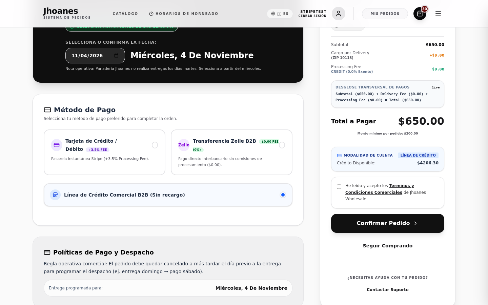
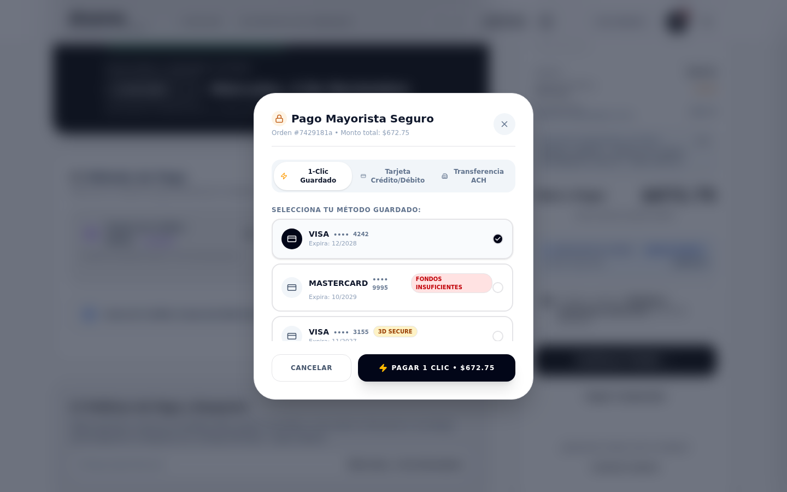
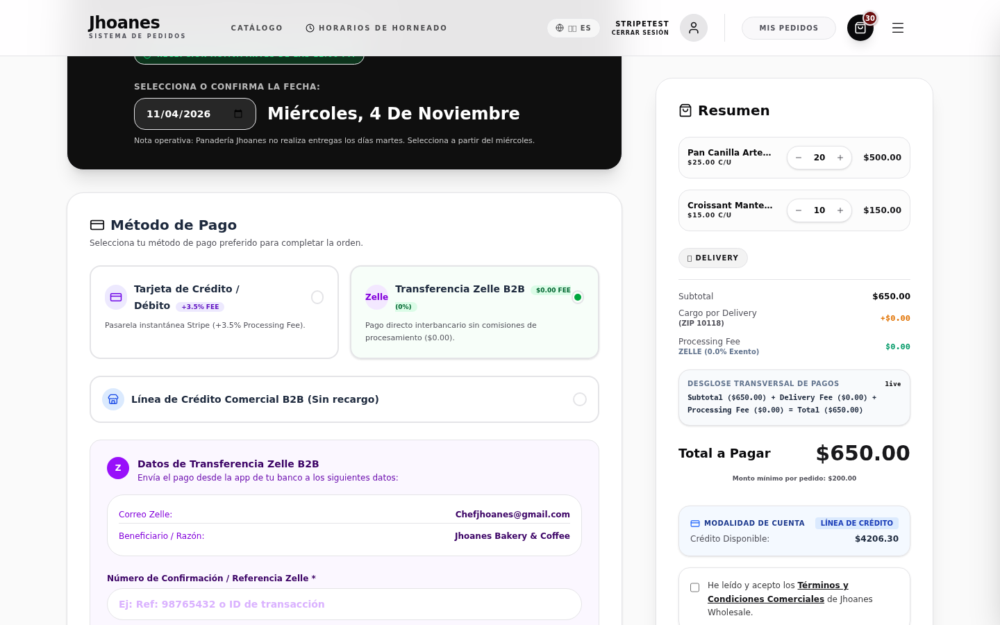
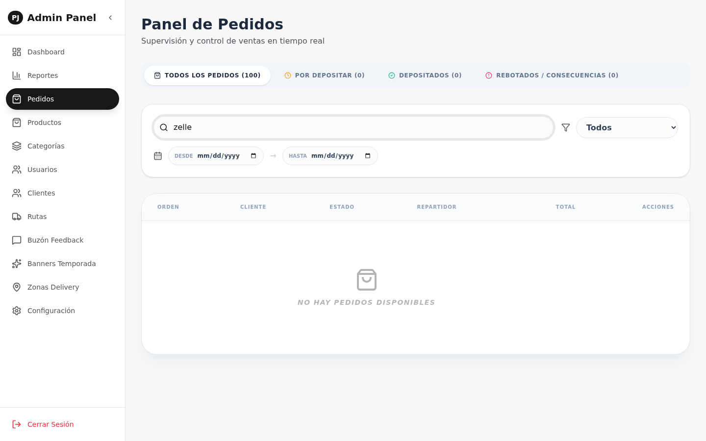
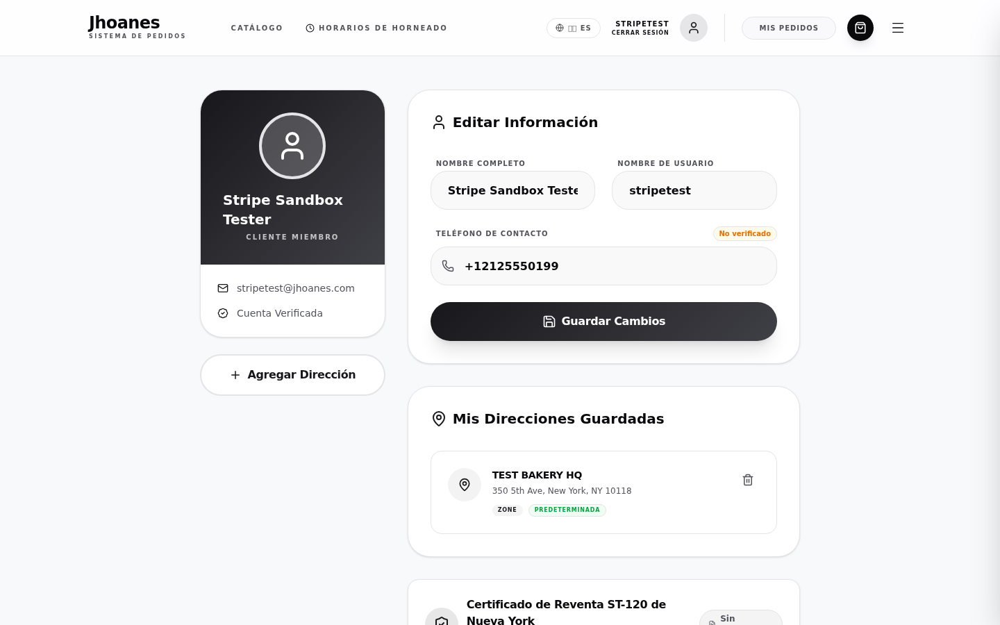
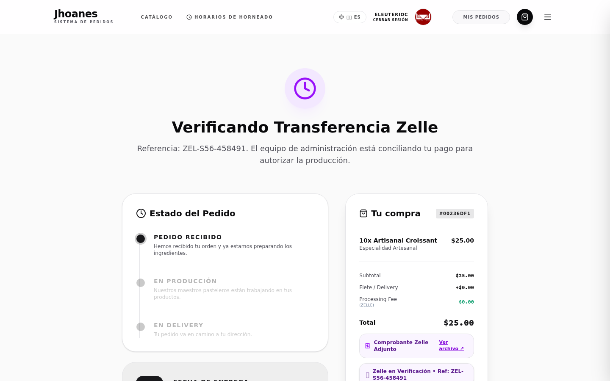
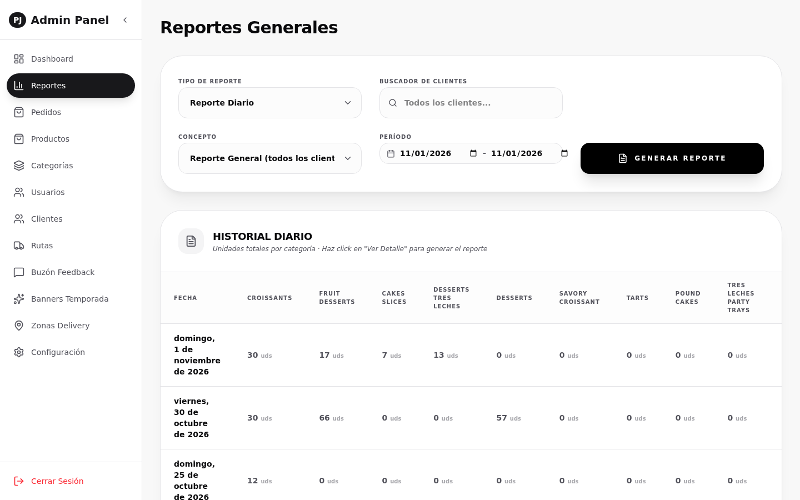

# MANUAL OPERATIVO ILUSTRADO: MEDIOS DE PAGO, CONCILIACIÓN Y REPORTES CONTABLES
**Jhoanes Wholesale & Bakery**  
**Audiencia**: Gerencia General, Administración, Tesorería, Facturación y Servicio al Cliente  
**Fecha de Emisión**: Noviembre 2026  
**Versión**: 2.0 (Ilustrada con Capturas de Producción en Vivo)  

---

## 1. INTRODUCCIÓN Y ALCANCE
Este manual operativo ilustrado proporciona a la gerencia y al equipo de operaciones de **Jhoanes Wholesale** una guía visual y práctica sobre el funcionamiento de los canales de cobro, los flujos de validación, la facturación comercial y los reportes contables automáticos, respaldado con las pantallas reales de la plataforma.

---

## 2. POLÍTICA DE CANALES DE PAGO Y EXPERIENCIA DEL CLIENTE EN CHECKOUT

Jhoanes Wholesale opera bajo una política de transparencia comercial conforme a la normativa del Estado de Nueva York. Las comisiones bancarias y de pasarela se desglosan de forma individual y no son absorbidas en ventas mayoristas:

| Medio de Pago | ¿Cómo Paga el Cliente? | Costo / Comisión | Tiempo de Confirmación | ¿Qué Requiere de Administración? |
| :--- | :--- | :--- | :--- | :--- |
| **Tarjeta de Crédito / Débito** | En línea al confirmar el pedido (Visa, Mastercard, Amex). | **3.5%** sobre el valor de los productos. | **Inmediato**: El cobro se procesa en segundos. | Ninguna acción manual. La orden pasa automáticamente a producción. |
| **Transferencia ACH (Bancaria Directa)** | En línea vinculando su cuenta corriente comercial (exclusivo VIP/Autorizados). | **0.8%** (con **tope máximo de $5.00** por orden). | **3 a 5 días hábiles** para la liquidación efectiva en cuenta. | Verificación en extracto bancario en caso de devoluciones por cuenta sin fondos. |
| **Transferencia Zelle B2B** | Desde su banca móvil a `Chefjhoanes@gmail.com`. | **$0.00 (0% - Exento)**. | **Manual**: Sujeto a cotejo bancario del equipo de tesorería. | **Obligatorio**: Revisar el comprobante y aprobar o rechazar la orden en el panel. |
| **Cheque Comercial** | Cheque físico entregado al chofer en ruta o en el mostrador. | **$0.00 (0% - Exento)**. | **+3 días hábiles** tras ser depositado en el banco. | Registrar número de cheque, depositar en banco y marcar fecha en el sistema. |
| **Línea de Crédito Comercial B2B** | Compra con cargo a su cupo aprobado, pagadero a 7 días. | **$0.00 (0% - Exento)**. | **Inmediato**: Siempre que no exceda su límite de crédito disponible. | Cobranza semanal o quincenal según acuerdo comercial. |
| **Notas de Crédito / Saldos a Favor** | Aplicadas por devoluciones, ajustes de inventario o modificaciones de orden. | **$0.00 (Deducción 1 a 1)**. | **Inmediato**: Resta directamente el saldo deudor de la factura. | Emisión de la nota desde el detalle de la orden con motivo formal. |

### Pantalla 1: Selector de Métodos de Pago en el Checkout
El cliente mayorista visualiza con absoluta transparencia las opciones habilitadas para su cuenta y las comisiones correspondientes:

> [!TIP]
> **Claridad Comercial**: Al seleccionar Tarjeta o ACH, el sistema calcula en tiempo real la comisión de procesamiento y la añade al resumen sin alterar el precio base de los productos de panadería.

---

## 3. PASARELA STRIPE: PAGOS CON TARJETA Y DÉBITO ACH

Cuando el cliente selecciona Tarjeta de Crédito/Débito o Débito ACH, el sistema despliega el modal interactivo de pago seguro:

### Pantalla 2: Modal de Pago Rápido y ACH
El modal permite guardar la tarjeta para futuros pedidos ("1-Clic Payment") o ingresar una nueva cuenta bancaria comercial:

### Pantalla 3: Manejo de Fondos Insuficientes y Desafíos de Seguridad
Si una tarjeta es declinada o el banco del cliente exige verificación de seguridad en dos pasos (3D Secure), el sistema informa de inmediato sin congelar la pantalla:

---

## 4. GESTIÓN Y CONCILIACIÓN DE PAGOS ZELLE B2B

El canal Zelle está diseñado para clientes que prefieren pagar vía transferencia bancaria sin pagar recargos de pasarela.

### A. Experiencia del Cliente al Subir Comprobante
El cliente visualiza la cuenta oficial de la empresa (`Chefjhoanes@gmail.com` / Jhoanes Bakery & Coffee) y debe completar dos campos obligatorios para poder confirmar su compra:
1. **Número de Referencia Bancaria**.
2. **Carga del archivo del comprobante** (captura de pantalla o PDF del banco).

### Pantalla 4: Formulario de Carga Zelle en Checkout

### B. Visor Administrativo de Comprobantes en `/admin/orders`
La orden entra en el panel como *"Pendiente de Verificación Zelle"*. La administración puede ver la foto del comprobante y cotejarla con la cuenta bancaria de Jhoanes Bakery:

### Pantalla 5: Panel de Verificación Zelle para Tesorería

### C. Procedimiento Operativo: Aprobar vs Rechazar
- **Aprobar Zelle**: Se confirma la recepción del dinero en la cuenta bancaria. Al hacer clic en *"Aprobar"*, el sistema marca la orden como *"Pagado"*, la transfiere automáticamente al horneado de cocina y le despacha al cliente su **Recibo de Compra**.
- **Rechazar Zelle**: Si la transferencia no existe, el monto es inferior o la referencia no concuerda:
  1. El operador hace clic en *"Rechazar Zelle"*.
  2. Escribe el motivo concreto (ej. *"Monto recibido $150 no coincide con el total de $285"*).
  3. **El sistema envía automáticamente un correo al cliente** con el motivo del rechazo y un botón para reintentar el pago o adjuntar un nuevo comprobante.

---

## 5. CONCILIACIÓN DE CHEQUES COMERCIALES

Para los clientes mayoristas autorizados a pagar con cheque físico en ruta o entrega en mostrador, el panel de administración centraliza la cartera de cheques en tres pestañas:

### Pantalla 6: Bandejas de Conciliación de Cheques

### Ciclo Operativo del Cheque:
1. **Por Depositar (En Cartera)**: Cheques físicos recibidos de los repartidores que aún no se han llevado al banco.
2. **Depositados**: Una vez depositados en la sucursal, se marcan como *"Depositados"*. Durante los **3 días hábiles bancarios** posteriores permanecen en tránsito hasta su compensación definitiva.
3. **Rebotados / Consecuencias**: Si el banco devuelve el cheque por falta de fondos:
   - Se marca como *"Rebotado"*.
   - El sistema anula el pago, reactiva la deuda de la orden y bloquea temporalmente al cliente para que no pueda volver a pagar con cheque hasta que liquide su saldo con tesorería.

---

## 6. LÍNEAS DE CRÉDITO B2B Y SALUD FINANCIERA DEL CLIENTE

Los clientes con línea de crédito comercial aprobada pueden monitorear en todo momento el estado de su cuenta corriente desde su portal personal:

### Pantalla 7: Ficha de Salud Financiera en `/profile`

> [!NOTE]
> **Alertas Preventivas de Crédito**:
> - Al superar el **80% del límite**, el sistema envía una alerta por correo para que el cliente planifique su próximo pago.
> - Si excede el 100% sin autorización de sobregiro, el sistema no permite colocar nuevos pedidos a crédito hasta que liquide las facturas pendientes.
> - El cliente dispone de un botón directo para acceder al **Portal de Facturación Stripe** y liquidar sus saldos en línea con tarjeta o ACH.

---

## 7. NOTAS DE CRÉDITO Y FACTURACIÓN COMERCIAL LEGAL

Toda devolución de mercancía, ajuste de precio o anulación genera una **Nota de Crédito oficial con folio correlativo** (`NC-YYYY-XXXX`).

### Pantalla 8: Factura Comercial con Desglose Fiscal Legal
Al imprimir o consultar la factura en `/orders/[id]`, se muestra el desglose completo exigido por las normas contables:

### Componentes de la Factura Legal:
1. **Subtotal de Productos de Panadería**: Exentos de Sales Tax ST-120 según la normativa fiscal de alimentos en NYS.
2. **Delivery Fee**: Tarifa de transporte y logística.
3. **Processing Fee (Comisión Bancaria)**: Desglosada como cargo financiero separado (3.5% o 0.8% ACH).
4. **Nota de Crédito Formal (`NC-YYYY-XXXX`)**: Monto descontado de forma visible en color rojo con su respectivo motivo.
5. **Saldo Neto Exigible**: Valor final matemático que el cliente debe pagar tras deducir sus créditos.

---

## 8. INFORMES CONTABLES AUTOMÁTICOS Y CIERRE DIARIO

### A. Despacho Diario a las 23:59 NYS
Para asegurar un cierre contable sin trabajo manual nocturno, el sistema compila automáticamente todas las noches a las **11:59 PM (hora de Nueva York)** las ventas del día y despacha un archivo **Excel estructurado** por correo electrónico.

### Pantalla 9: Panel de Reportes y Exportación a Excel en `/admin/reports`

### B. Configuración de Destinatarios en `/admin/settings`
La administración puede agregar, editar o remover los correos contables en cualquier momento:
1. Diríjase a [`/admin/settings`](file:///home/opc/code/pj-air/frontend/app/admin/settings/page.tsx).
2. Ubique la sección **"Informes Contables Automáticos"**.
3. Ingrese las direcciones deseadas separadas por coma (ejemplo: `accounting@jhoanes.com, gerencia@jhoanes.com`).
4. Presione **"Guardar Configuración"**.

---

## 9. RESUMEN DE BENEFICIOS OPERATIVOS PARA JHOANES WHOLESALE

1. **Blindaje de Cobros**: Cero pérdidas en Zelle gracias a la obligatoriedad del comprobante y el visor de tesorería.
2. **Comunicación Ágil con el Cliente**: Notificaciones claras con botón de reintento ante comprobantes no conciliados.
3. **Conciliación de Cheques Controlada**: Trazabilidad completa desde la recepción física hasta la confirmación bancaria a 3 días.
4. **Cierre Contable Sin Esfuerzo**: Reporte consolidado en Excel en la bandeja de entrada cada mañana a primera hora.
5. **Transparencia Fiscal Total**: Facturas con desglose legal conforme a las leyes del Estado de Nueva York.
